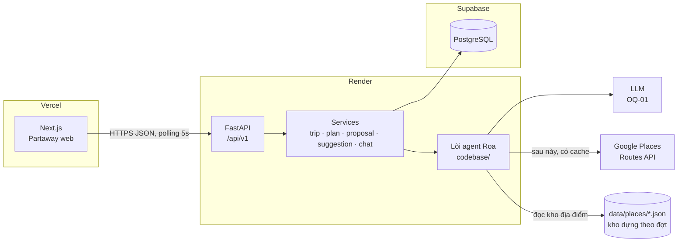
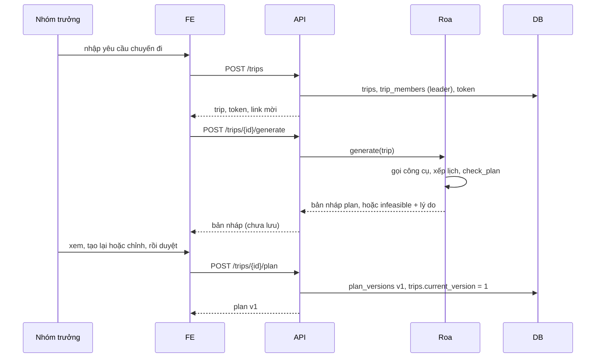
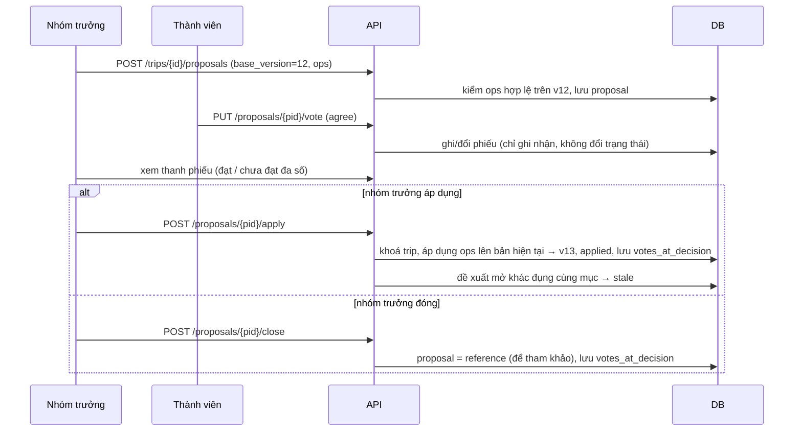

# ARCHITECTURE.md — Kiến trúc Partaway

| | |
|---|---|
| Phiên bản | 0.9 |
| Trạng thái | Nháp |
| Người phụ trách | Khương (backend) |
| Người duyệt | Cả nhóm |
| Cập nhật | 2026-11-28 |
| Đi kèm | `docs/DATABASE.md`, `docs/API_SPEC.md`, `docs/adr/` |

Tài liệu mô tả hệ thống chạy thế nào và vì sao. Chi tiết bảng ở `docs/DATABASE.md`, chi tiết endpoint ở `docs/API_SPEC.md`. Chỗ còn mở đánh dấu `[NEEDS CLARIFICATION]` kèm mã `OQ-xx`.

## 1. Mục tiêu và ràng buộc

- **Lát cắt demo phải chạy trơn:** tạo chuyến đi → Roa tạo plan v1 → nhóm trưởng sửa → đề xuất → cả nhóm bỏ phiếu → v2 → thành viên hỏi Roa.
- **Thời gian:** 2 ngày, 4 người. Ưu tiên thứ đơn giản, ít thành phần, dùng gói miễn phí.
- **Không mất dữ liệu khi nhiều người cùng thao tác:** phiếu không bị đếm trùng, đề xuất không áp dụng lên bản plan đã đổi mà không kiểm.
- **Giữ khung chấm của BTC chạy được:** `python run.py eval` và `simulate` phải gọi đúng lõi agent mà web app dùng (ADR 0003).
- **Chi phí API có kiểm soát:** cache Google Places; hạn mức gọi API; giới hạn số lần hỏi Roa.

## 2. Tổng quan



- Frontend chỉ nói chuyện với backend. Không gọi thẳng Supabase, Google hay LLM từ trình duyệt (không lộ key).
- Một tiến trình backend, một database. Không có hàng đợi hay worker riêng: việc theo thời gian (hạn đề xuất, nếu nhóm trưởng đặt) tính lười khi đọc (mục 6.4).

## 3. Thành phần

### 3.1 Frontend (`frontend/`)

| Màn hình | Ai thấy | Nội dung chính |
|---|---|---|
| Tạo chuyến đi | Nhóm trưởng | Điểm đến, ngày, số người, ngân sách, sở thích, ràng buộc; xem bản nháp Roa soạn, tạo lại hoặc duyệt thành v1 |
| Tham gia | Người có link mời | Nhập tên hiển thị |
| Không gian chuyến đi | Mọi thành viên | Cột trái: thông tin, danh sách ngày, lịch sử phiên bản. Giữa: timeline theo ngày. Phải: tab "Trò chuyện" (hỏi Roa) và "Đề xuất" (bỏ phiếu) |
| Chế độ sửa | Chỉ nhóm trưởng | Sửa trên bản nháp cục bộ → xem diff → gửi thành đề xuất; hoặc nhờ Roa soạn |
| Form góp ý | Thành viên | Chọn ngày/mục, loại góp ý, nội dung |
| Hộp góp ý | Nhóm trưởng | Danh sách góp ý; chuyển thành đề xuất, ghi nhận hoặc từ chối |

- Trạng thái lấy từ backend; frontend không tự tính tổng chi phí, số phiếu hay trạng thái đề xuất (R-41).
- Cập nhật bằng polling `GET /trips/{id}/updates` mỗi 5 giây khi tab đang mở (OQ-10).

### 3.2 Backend (`backend/`)

```
backend/app/
  main.py            khởi tạo FastAPI, CORS, router
  core/              config (đọc env), db session, lỗi chuẩn, xác thực thành viên
  api/               router theo nhóm endpoint; chỉ nhận/trả DTO, gọi service (R-10)
  schemas/           Pydantic DTO, gồm schema của plan và ops
  services/          logic nghiệp vụ, giữ ranh giới transaction (R-11)
  db/                model SQLAlchemy, migration Alembic
backend/tests/
```

| Service | Việc |
|---|---|
| `trip_service` | Tạo chuyến đi, link mời, thành viên, quyền nhóm trưởng |
| `plan_service` | Đọc phiên bản, duyệt bản nháp thành v1, áp dụng `ops` lên plan, tính diff giữa hai phiên bản, kiểm plan hợp lệ |
| `proposal_service` | Tạo đề xuất, ghi phiếu, tính "đạt / chưa đạt đa số", áp dụng và đóng theo lệnh nhóm trưởng, đánh dấu cũ (stale), hạn tuỳ chọn |
| `suggestion_service` | Góp ý của thành viên, xử lý của nhóm trưởng |
| `chat_service` | Lưu hội thoại, gọi Roa ở chế độ hỏi, giới hạn tần suất |
| `agent_service` | Cầu nối duy nhất từ backend sang lõi Roa trong `codebase/`; ghi `agent_runs` |

### 3.3 Lõi agent Roa (`codebase/`, ADR 0003 — đề xuất)

Ba chế độ, cùng bộ công cụ:

| Chế độ | Ai gọi | Đầu vào | Đầu ra | Ghi gì |
|---|---|---|---|---|
| `generate` | Nhóm trưởng, lúc tạo chuyến đi | Thông tin chuyến đi | Plan JSON theo ngày, hoặc `infeasible` kèm lý do | Không ghi gì. Nhóm trưởng xem bản nháp rồi duyệt thì backend mới lưu v1, không qua phiếu (ADR 0004) |
| `draft` | Nhóm trưởng | Plan hiện tại + yêu cầu tự nhiên | `ops` + tóm tắt + lý do | Không ghi gì. Nhóm trưởng xem diff rồi tự gửi đề xuất |
| `ask` | Mọi thành viên | Plan hiện tại + câu hỏi | Câu trả lời tiếng Việt | Chỉ lưu tin nhắn |

**Lát cắt nộp BTC là `generate` (OQ-19).** Quyết định AI trung tâm: Roa xếp lịch trình theo ngày thoả giờ mở cửa và ngân sách, hoặc nói rõ là không xếp được và vì sao. `answer(text)` của khung BTC nhận yêu cầu chuyến đi bằng tiếng Việt, gọi `generate` và trả lịch trình (hoặc lý do không xếp được) dạng văn bản trong `{"output": ...}`, để `eval` đo đúng lõi mà web dùng. `ask`, `draft` là phần phụ cho web app, không nằm trong bộ câu thử chính.

Công cụ (mỗi hàm một `@tool` trong `codebase/tools.py`, tên khớp `spec.md` §4). Bản hiện tại đọc kho file `data/places/<thanh-pho>.json`, không gọi mạng:

| Công cụ | Việc | Tác động ra ngoài |
|---|---|---|
| `search_places` | Tìm địa điểm theo thành phố, loại, sở thích (chay) | Không (đọc kho) |
| `get_trending_spots` | Quán hot theo thành phố | Không (đọc kho thu trước) |
| `get_opening_hours` | Giờ mở, đóng cửa theo mã | Không |
| `get_travel_time` | Thời gian đi xe máy giữa hai mã địa điểm (ước tính bằng code) | Không |
| `check_itinerary` | Kiểm giờ mở cửa, chồng giờ, thời gian di chuyển, khung giờ, ngân sách | Không |

**Luồng `generate` chi tiết** (sơ đồ B1–B10, ai gọi ai, khung giờ, nhánh trả lời ↔ câu thử, giới hạn): xem [`docs/roa-agent-flow.md`](docs/roa-agent-flow.md). Tóm tắt: code chặn sớm các trường hợp từ chối, thiếu thông tin, chưa có dữ liệu, mâu thuẫn ngân sách, không khả thi bằng mẫu câu trả lời; còn lại code dựng bản nháp, model chọn lại theo mã ứng viên, `check_itinerary` kiểm, model sửa tối đa một lần, code in kết quả. Model không tính giờ, tiền hay thời gian đi.

Không có công cụ ghi plan. Ghi plan chỉ xảy ra khi nhóm trưởng duyệt v1 (`plan_service`) hoặc áp dụng đề xuất (`proposal_service`) (R-31).

### 3.4 Database (Supabase)

PostgreSQL thuần, truy cập qua SQLAlchemy từ backend. Không dùng Supabase Auth, Realtime, Storage ở MVP (OQ-06, OQ-10). Bảng: `docs/DATABASE.md`.

## 4. Luồng chính

### 4.1 Tạo chuyến đi và plan v1



### 4.2 Sửa plan → đề xuất → bỏ phiếu → nhóm trưởng áp dụng



Nhóm trưởng có hai cách tạo `ops`: sửa trực tiếp trên bản nháp ở frontend (frontend sinh `ops` từ thao tác), hoặc nhờ Roa (`POST /trips/{id}/proposals/draft`) rồi sửa tiếp nếu cần.

### 4.3 Góp ý của thành viên

Thành viên gửi form → `suggestions` (new). Nhóm trưởng mở hộp góp ý và chọn: **Tạo đề xuất** (mở chế độ sửa, điền sẵn nội dung góp ý; đề xuất tạo ra có `suggestion_id`), **Ghi nhận** hoặc **Từ chối** (kèm ghi chú). Góp ý không bao giờ tự sửa plan.

### 4.4 Hỏi Roa

Thành viên gửi câu hỏi → `chat_service` kiểm giới hạn tần suất → Roa `ask` trên phiên bản hiện tại → lưu câu hỏi và câu trả lời kèm `plan_version` đã dùng. Câu hỏi mang ý sửa plan ("đổi quán ăn trưa ngày 2") thì Roa trả lời và gợi ý gửi góp ý cho nhóm trưởng, không tạo đề xuất (R-32).

### 4.5 Khôi phục phiên bản cũ

Nhóm trưởng chọn v9 trong lịch sử → `POST /trips/{id}/proposals` với `kind = revert`, `target_version = 9`. Cả nhóm bỏ phiếu như mọi đề xuất, nhóm trưởng áp dụng; áp dụng xong tạo phiên bản mới có nội dung bằng v9 (I1).

## 5. Dữ liệu ngoài

- **Google Places (Text Search, Place Details), Routes/Directions:** chỉ gọi từ backend. Kết quả cache trong `places_cache` theo khoá truy vấn, hết hạn sau 7 ngày (giờ mở cửa) [NEEDS CLARIFICATION: thời hạn cache, OQ-12]. Chỉ xin trường cần dùng (field mask) để giảm chi phí.
- **Kho địa điểm (đang dùng):** `data/places/<thanh-pho>.json`, dựng theo đợt bằng `scripts/build_place_store.py` từ danh mục OpenStreetMap (qua Geoapify) và bộ mẫu CP2. Hiện có Đà Lạt (94 nơi). Thành phố chưa có kho thì Roa báo chưa có dữ liệu (OQ-22). Chi tiết: `data/DATA_CARD.md` Dataset 2, `docs/roa-agent-flow.md` §5.
- **Kho quán hot:** thu trước từ TikTok/Instagram cho một số điểm đến (phạm vi theo OQ-11), làm sạch, lưu `trending_spots`. Không crawl lúc chạy, không lưu thông tin cá nhân người đăng. Nguồn, cách thu và giới hạn ghi ở `data/DATA_CARD.md` (OQ-11).
- **Dữ liệu "trong khoảng 2 quý đổ lại":** chỉ dùng mục trong kho có `collected_at` trong 6 tháng gần nhất.

## 6. Đồng thời và nhất quán

Chỉ nhóm trưởng tạo và áp dụng thay đổi, nên không cần khoá mềm theo mục khi sửa. Rủi ro đồng thời nằm ở nhóm trưởng bấm áp dụng hai lần, phiếu đến cùng lúc với áp dụng, và nhiều đề xuất mở cùng lúc.

### 6.1 Áp dụng trong một transaction

Áp dụng, đóng đề xuất và duyệt v1 chạy trong một transaction, khoá dòng `trips` bằng `SELECT … FOR UPDATE`; bỏ phiếu cũng lấy khoá đó để `votes_at_decision` khớp với phiếu lúc quyết. Hai request áp dụng đến cùng lúc vẫn chỉ tạo một phiên bản; `plan_versions (trip_id, version_no)` là khoá duy nhất (I2).

### 6.2 Phiếu

Một thành viên một phiếu cho mỗi đề xuất (khoá chính `(proposal_id, member_id)`). Đổi ý khi đề xuất còn mở thì ghi đè phiếu. Bỏ phiếu lại cùng giá trị là thao tác idempotent.

### 6.3 Đề xuất cũ (stale)

Đề xuất lưu `base_version`. Khi áp dụng một đề xuất:

1. Nếu `base_version` = phiên bản hiện tại: áp dụng thẳng.
2. Nếu nhỏ hơn: so các mục mà `ops` đụng tới với các mục đã đổi từ `base_version` đến hiện tại (diff theo `id` mục). Không trùng thì áp dụng `ops` lên bản hiện tại. Trùng thì đánh dấu `stale`, không áp dụng; nhóm trưởng tạo lại từ bản mới.
3. Sau mỗi lần áp dụng, các đề xuất mở khác đụng cùng mục được đánh dấu `stale` ngay.

### 6.4 Hạn đề xuất, tính lười

Hạn là tuỳ chọn: chỉ đề xuất có `expires_at` (nhóm trưởng đặt khi tạo) mới hết hạn (OQ-03). Không có job chạy nền (Render gói miễn phí ngủ khi không có request). Mọi lần đọc, bỏ phiếu hoặc áp dụng một đề xuất có hạn, service kiểm `expires_at` trước; quá hạn thì chuyển `reference` trong cùng transaction.

### 6.5 Ngưỡng phiếu

Ngưỡng tham khảo là **quá bán số thành viên** (`floor(n/2) + 1`; 4 người cần 3), phiếu của nhóm trưởng tự tính là đồng ý khi tạo (OQ-02). Phiếu chỉ để ghi lại biểu quyết và hiện "Đạt / Chưa đạt đa số"; backend không tự áp dụng hay tự đóng theo số phiếu. Nhóm trưởng quyết; áp dụng khi chưa đạt đa số thì frontend hỏi xác nhận (ADR 0004).

## 7. Agent và LLM

- **Một chỗ gọi model:** `codebase/ai.py` `call_model()`. Backend không gọi SDK LLM ở chỗ khác (R-30).
- **Ra `ops` có cấu trúc:** `draft` và `generate` phải trả JSON đúng schema ở `docs/DATABASE.md` mục 3; backend kiểm bằng Pydantic, lỗi thì thử lại một lần rồi báo `llm_invalid_output` (R-33).
- **Kiểm sau model:** chạy `check_itinerary` trên kết quả (`generate`: sai thì nhờ model sửa một lần, vẫn sai thì giữ bản nháp của code — `docs/roa-agent-flow.md` §2); mục đóng cửa, chồng giờ, vượt ngân sách được ghi thành cảnh báo đi kèm đề xuất, không tự sửa.
- **Dữ liệu người dùng là dữ liệu:** ghi chú, góp ý, tên địa điểm có thể chứa câu lệnh; đưa vào prompt trong khối dữ liệu có đánh dấu, không phải chỉ dẫn (R-34).
- **Giới hạn:** mỗi lượt agent tối đa `MAX_STEPS` lần gọi công cụ; mỗi thành viên tối đa N câu hỏi/phút (R-35, API_SPEC mục 1.5).
- **Model:** chưa chốt (OQ-01). Tiêu chí chọn: gọi công cụ ổn định, tiếng Việt tốt, trả JSON đúng schema, độ trễ, gói miễn phí hoặc chi phí theo `cost/`.

## 8. Deploy và môi trường

| Thành phần | Host | Ghi chú |
|---|---|---|
| Frontend | Vercel | Build từ thư mục `frontend/`; preview theo PR |
| Backend | Render (Web Service) | Build từ `backend/` + `codebase/`; lệnh chạy `uvicorn app.main:app --host 0.0.0.0 --port $PORT`; gói miễn phí ngủ sau ~15 phút không có request, lần gọi đầu chậm → mở trước buổi demo |
| Database | Supabase | Kết nối qua connection pooler (Render không có IPv6 tới kết nối trực tiếp); migration chạy bằng Alembic từ máy dev hoặc lệnh build |

Biến môi trường (giá trị giả trong `.env.example`):

| Biến | Ở đâu | Việc |
|---|---|---|
| `DATABASE_URL` | Backend | Chuỗi kết nối Supabase (pooler) |
| `MODEL_PROVIDER`, `MODEL_NAME`, `API_KEY` | Backend | LLM, dùng chung với khung BTC |
| `GWAI_API_KEY` | Backend | Key riêng khi dùng `MODEL_PROVIDER=gwai`. `MODEL_NAME` bắt đầu bằng `gemini` thì gọi `generateContent` của GWAI, model khác gọi Chat Completions |
| `GOOGLE_MAPS_API_KEY` | Backend | Places, Routes |
| `VIETMAP_API_KEY` | Lõi Roa phía server | Tra điểm ngoài kho qua VIETMAP Autocomplete v4 và Place v4. Chưa dùng: bản chạy thử chỉ đọc kho file (chờ OQ-22) |
| `TAVILY_API_KEY` | Lõi Roa phía server | Tra bổ sung giờ và giá/người theo tên, thành phố. Chưa dùng lúc chạy: theo `docs/roa-agent-design.md` chỉ tra theo đợt khi dựng kho |
| `GEOAPIFY_API_KEY` | Backend | Geocoding và Places của Geoapify cho đợt thu kho địa điểm theo thành phố (OQ-22, `docs/DATABASE.md` mục 5). Routing chưa dùng |
| `FRONTEND_BASE_URL` | Backend | Gốc URL frontend để dựng `invite_url` |
| `STORE_TTL_DAYS` | Backend | Hạn kho địa điểm (ngày). Để trống: kho không hết hạn [NEEDS CLARIFICATION: OQ-12] |
| `STORE_MAX_CAFE`, `STORE_MAX_FOOD` | Backend | Số quán cafe, quán ăn tối đa mỗi thành phố, mặc định 60 *(tự ước tính)*; điểm tham quan không giới hạn |
| `CORS_ORIGINS` | Backend | Domain Vercel (production và preview) |
| `NEXT_PUBLIC_API_BASE_URL` | Frontend | URL backend trên Render |

Nhánh và deploy: `main` là bản demo; `develop` là nhánh tích hợp (`docs/DEVELOPMENT.md`).

## 9. Bảo mật và quyền

- **Xác thực (đã chốt, OQ-06):** không có tài khoản. Tham gia bằng link mời + tên hiển thị; backend cấp token ngẫu nhiên, lưu băm trong `trip_members.token_hash`; frontend gửi `Authorization: Bearer <token>`.
- **Quyền:** kiểm ở backend cho mọi endpoint (R-20). Bảng quyền: `docs/API_SPEC.md` mục 1.4.
- Không log token, key, chuỗi kết nối (R-22). Không đưa token vào URL ngoài link mời (link mời chỉ chứa `invite_code`).

## 10. Quan sát

- `agent_runs` ghi mỗi lượt Roa: chế độ, model, token vào/ra, độ trễ, kết quả. Dùng cho `cost/` và slide.
- Khung BTC ghi trace riêng khi chạy `eval`/`simulate` (`codebase/tracing.py`).
- Log backend dạng một dòng mỗi request: method, path, status, thời gian, `trip_id`.

## 11. Rủi ro

| Rủi ro | Ảnh hưởng | Cách giảm |
|---|---|---|
| Render ngủ, request đầu chậm lúc demo | Demo khựng | Mở trước 5 phút; có video dự phòng |
| LLM trả JSON sai schema | Không tạo được bản nháp v1 hoặc đề xuất | Kiểm schema, thử lại 1 lần, báo lỗi rõ |
| Hết quota Google API | Không tra được giờ mở cửa | Cache, hạn mức gọi API, dữ liệu mẫu dự phòng |
| Chưa chốt LLM trước tối 27/11 | Trễ CP3 | OQ-01 ưu tiên cao |
| Kho quán hot ít, cũ | Gợi ý kém | Thu tập nhỏ có chọn lọc; điểm đến chưa có trong kho thì Roa chỉ dùng Google Places và nói rõ (OQ-11) |

## Lịch sử thay đổi

| Phiên bản | Ngày | Người sửa | Nội dung | Căn cứ |
|---|---|---|---|---|
| 0.1 | 2026-11-27 | Khương | Bản đầu: thành phần, luồng đề xuất và bỏ phiếu, đồng thời, deploy | ADR 0001, 0002, 0003 |
| 0.2 | 2026-11-27 | Khương | Đánh dấu chế độ `answer(text)` gọi là chỗ chờ OQ-19 | Đối chiếu yêu cầu BTC |
| 0.3 | 2026-11-27 | Khương | `answer(text)` gọi `generate` (lát cắt nộp BTC); `generate` trả bản nháp, nhóm trưởng duyệt v1; phiếu chỉ ghi nhận, nhóm trưởng áp dụng / đóng; hạn tuỳ chọn; bỏ `PROPOSAL_TTL_HOURS`; chốt xác thực | OQ-19, ADR 0004, OQ-06 |
| 0.4 | 2026-11-27 | Khương | Bỏ giới hạn thành phố demo: điểm đến bất kỳ trong Việt Nam; kho quán hot chỉ phủ một số điểm đến | OQ-09 |
| 0.5 | 2026-11-28 | Khương | Bảng công cụ §3.3 khớp tên trong code và `spec.md` §4; Roa đọc kho file `data/places/`; luồng `generate` chi tiết tách sang `docs/roa-agent-flow.md` | Code nhánh `feat/kho-du-lieu-va-agent-roa` |
| 0.6 | 2026-11-28 | Codex | Bổ sung cấu hình VIETMAP và Tavily cho công cụ của bản chạy thử | Yêu cầu triển khai công cụ Roa |
| 0.7 | 2026-11-28 | Khương | Gộp nhánh agent: lõi Roa đọc cả `data/places/` và `data/places_vn.json` (5 thành phố); bản chạy thử không gọi VIETMAP, Tavily, Google lúc chạy (chờ OQ-22), nên `VIETMAP_API_KEY`, `TAVILY_API_KEY` chưa dùng | Gộp `feat/kho-du-lieu-va-agent-roa` với `docs/cp2-benchmark-datacard` |
| 0.8 | 2026-11-28 | Khương | `GWAI_API_KEY`: model Gemini đi đường `generateContent` của GWAI | Chạy eval CP3 bằng `gemini-3.8-flash` |
| 0.9 | 2026-11-28 | Khương | Biến môi trường kho địa điểm (`STORE_*`, `FRONTEND_BASE_URL`); Geoapify dùng cho đợt thu kho; sửa ô phiên bản ở đầu file | OQ-22, code `backend/` |
