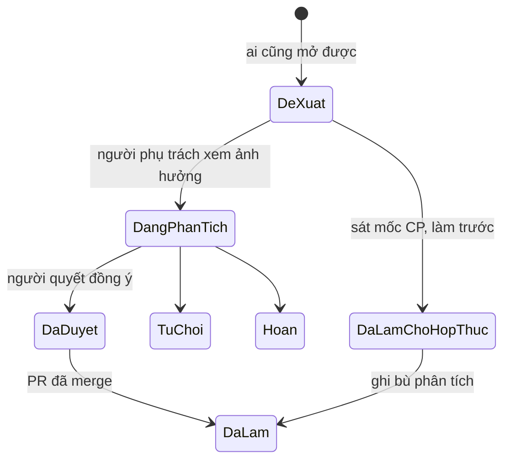

# CHANGE-MANAGEMENT.md — Quản lý thay đổi

| | |
|---|---|
| Phiên bản | 0.1 |
| Trạng thái | Nháp |
| Người phụ trách | Đức (đội trưởng) |
| Người duyệt | Cả nhóm |
| Cập nhật | 2026-11-27 |

Cách đặt mã, phân loại thay đổi và đổi quyết định đã chốt mà không làm lệch tài liệu với code. Hackathon 2 ngày nên quy trình gọn: phần lớn thay đổi chỉ cần PR; chỉ thay đổi lớn mới cần CR.

## 1. Hệ thống mã

| Mã | Dùng cho | Ở đâu | Đặt số |
|---|---|---|---|
| `R-xx` | Quy tắc bắt buộc | `docs/PROJECT-RULES.md` | Theo nhóm (R-0x quy trình, R-1x backend…) |
| `OQ-xx` | Câu hỏi còn mở | `docs/OPEN-QUESTIONS.md` | Tăng dần, không dùng lại |
| `CR-xxx` | Yêu cầu thay đổi | `docs/CHANGE-REQUESTS.md` | Tăng dần |
| `ADR NNNN` | Quyết định kiến trúc | `docs/adr/NNNN-<mo-ta>.md` | Tăng dần, 4 chữ số |
| `I<số>` | Bất biến dữ liệu | `docs/DATABASE.md` mục 4.2 | Tăng dần |
| `BR-xx` | Quy tắc nghiệp vụ trong một spec | Spec trong `docs/features/` | Riêng từng spec |
| `AC-x` | Tiêu chí nghiệm thu trong một spec | Spec trong `docs/features/` | Riêng từng spec |

Không có mã task. Việc được nhận diện bằng tên nhánh, tiêu đề PR và dòng trong `WORKLOG.md`.

## 2. Phân loại thay đổi

| Loại | Ví dụ | Cần gì |
|---|---|---|
| L0 — Sửa chữ | Lỗi chính tả, câu văn, định dạng | Commit; không tăng phiên bản tài liệu |
| L1 — Làm rõ | Thêm ví dụ, giải thích, không đổi nghĩa | PR; tăng phiên bản nhỏ (0.1 → 0.2) |
| L2 — Bổ sung trong phạm vi | Thêm endpoint, cột, quy tắc phụ không phá cái cũ | PR có tài liệu đi kèm (R-04); tăng phiên bản |
| L3 — Đổi contract | Đổi plan JSON, `ops`, payload hoặc mã lỗi đang dùng, xoá cột | **CR**; báo cả nhóm; frontend và backend sửa cùng lúc |
| L4 — Đổi quy tắc nghiệp vụ, quyền | Đổi ngưỡng phiếu, ai được sửa plan, vòng đời đề xuất | **CR**; ADR nếu đụng quyết định đã có ADR |
| L5 — Đổi kiến trúc, stack, phạm vi | Đổi host, DB, thêm tính năng ngoài MVP, đổi lát cắt demo | **CR** + **ADR mới**; đội trưởng quyết |

Không chắc loại nào thì chọn loại cao hơn.

## 3. Quy trình CR

Trạng thái: **Đề xuất** → **Đang phân tích** → **Đã duyệt** → **Đã làm** · hoặc **Từ chối** · **Hoãn** · **Đã làm, chờ hợp thức** (chỉ khi sát mốc CP, phải ghi bù phân tích trong ngày).

1. Thêm dòng vào `docs/CHANGE-REQUESTS.md` (trạng thái Đề xuất): thay đổi gì, vì sao, loại L3–L5.
2. Người phụ trách phần bị đụng ghi ảnh hưởng: tài liệu, bảng, endpoint, màn hình, eval nào phải sửa.
3. Người quyết (bảng mục 4) duyệt hoặc từ chối, ghi ngày.
4. Làm trong một PR; tiêu đề PR nhắc mã CR. Sửa mọi tài liệu ở bước 2.
5. Merge xong: trạng thái Đã làm; dòng `CHANGELOG.md`; ADR mới nếu L5.

## 4. Ai quyết

| Phần | Người phụ trách | Người quyết |
|---|---|---|
| Phạm vi, lát cắt demo, bài nộp BTC | Đức | Đức |
| Backend, DB, API, deploy Render/Supabase | Khương | Khương + Đức |
| Agent Roa, prompt, công cụ, eval | Toàn | Toàn + Đức |
| Frontend, UI, deploy Vercel | Phúc | Phúc + Đức |
| Quy tắc nghiệp vụ, quyền sửa plan | Đức | Cả nhóm |

## 5. Kiểm khi đổi

- [ ] Đã tìm mọi chỗ nhắc tới thứ bị đổi (`grep` theo tên bảng, endpoint, mã R/OQ/I).
- [ ] `DATABASE.md`, `API_SPEC.md`, spec, `ARCHITECTURE.md` khớp nhau.
- [ ] Ví dụ JSON trong tài liệu vẫn đúng.
- [ ] `frontend/lib/api.ts` và schema Pydantic khớp `API_SPEC.md`.
- [ ] Đổi prompt hoặc công cụ Roa: đã chạy lại eval (R-37).
- [ ] Tài liệu đã tăng phiên bản, có dòng "Lịch sử thay đổi" ghi căn cứ (CR, ADR, OQ).
- [ ] Sau CP4: ghi vào `spec.md` §10.

## 6. Phiên bản tài liệu

- Mỗi tài liệu kỹ thuật có khối phiên bản ở đầu (Phiên bản, Trạng thái, Người phụ trách, Người duyệt, Cập nhật) và bảng "Lịch sử thay đổi" ở cuối (`Phiên bản | Ngày | Người sửa | Nội dung | Căn cứ`).
- Phiên bản `0.x` khi còn Nháp; lên `1.0` khi cả nhóm duyệt (dự kiến ở CP2). Sau đó L1–L2 tăng số nhỏ (1.1), L3–L5 tăng số lớn (2.0).
- Trạng thái: **Nháp** → **Đã duyệt** → **Thay thế** (khi có tài liệu mới thay).
- ADR không sửa nội dung sau khi **Đã chấp nhận**; chỉ đổi trạng thái sang "Thay thế bởi ADR xxxx".
- `CHANGELOG.md` theo dạng Keep a Changelog: mục `[Chưa phát hành]`, nhóm Thêm / Thay đổi / Bỏ / Sửa lỗi / Bảo mật; khi merge vào `main` ở một mốc CP thì đổi thành `[CPn] - YYYY-MM-DD`.

## Lịch sử thay đổi

| Phiên bản | Ngày | Người sửa | Nội dung | Căn cứ |
|---|---|---|---|---|
| 0.1 | 2026-11-27 | Đức | Bản đầu: hệ thống mã không có mã task, L0–L5, quy trình CR, người quyết | Họp nhóm 27/11 |
