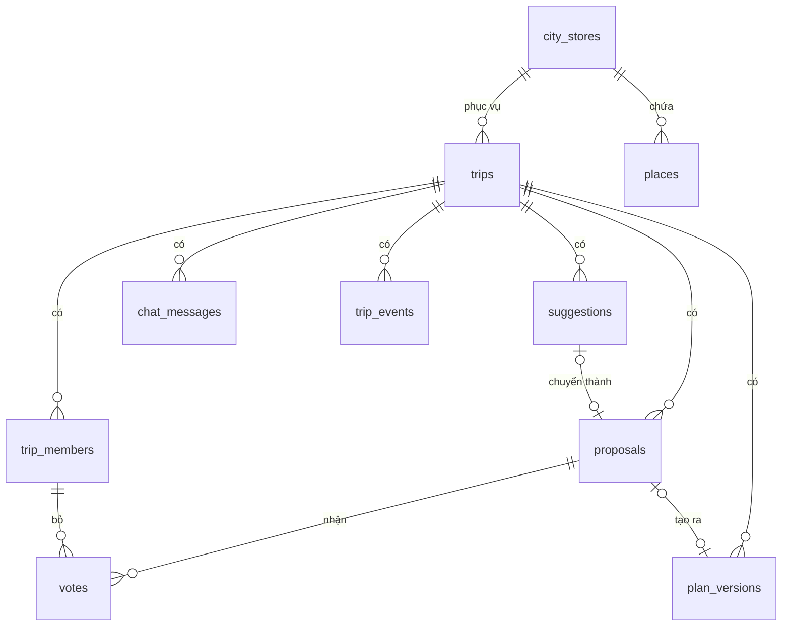
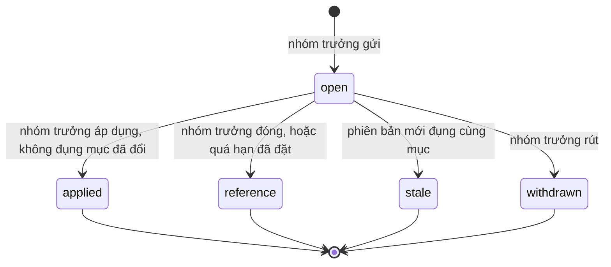
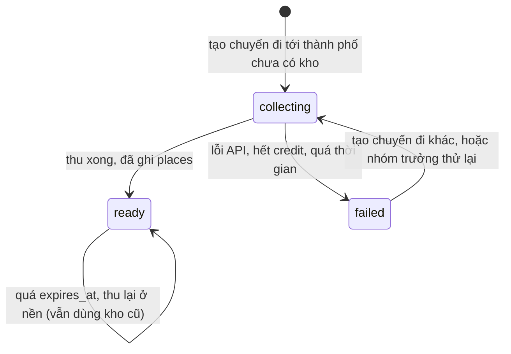

# DATABASE.md — Lược đồ dữ liệu Partaway

| | |
|---|---|
| Phiên bản | 0.3 |
| Trạng thái | Nháp |
| Người phụ trách | Khương (backend) |
| Người duyệt | Toàn (agent, cho mục 3), Phúc (frontend, cho mục 3) |
| Cập nhật | 2026-11-28 |
| Đi kèm | `ARCHITECTURE.md` mục 6, `docs/API_SPEC.md` |

PostgreSQL trên Supabase, truy cập qua SQLAlchemy 2 từ backend; migration bằng Alembic trong `backend/app/db/migrations/`, chỉ đi tiến. Tên bảng, cột tiếng Anh, `snake_case`. Thời gian là `timestamptz` (UTC). Tiền là số nguyên VND.

## 1. Tổng quan



| Bảng | Service sở hữu | Việc |
|---|---|---|
| `trips` | `trip_service` | Chuyến đi, phiên bản hiện tại, link mời |
| `trip_members` | `trip_service` | Thành viên, vai trò, token |
| `plan_versions` | `plan_service` | Mọi phiên bản plan, bất biến |
| `proposals` | `proposal_service` | Đề xuất sửa hoặc khôi phục |
| `votes` | `proposal_service` | Phiếu |
| `suggestions` | `suggestion_service` | Góp ý của thành viên |
| `chat_messages` | `chat_service` | Hỏi đáp với Roa |
| `trip_events` | Service gây ra sự kiện | Dòng sự kiện cho polling và nhật ký hoạt động |
| `agent_runs` | `agent_service` | Mỗi lượt Roa: token, độ trễ, kết quả |
| `places_cache` | `place_service` | Response thô Geoapify (geocode, places, details), routing; vứt đi được |
| `trending_spots` | Seed dữ liệu | Kho quán hot thu trước |
| `city_stores` | `place_service` | Trạng thái kho địa điểm của từng thành phố: đang thu, sẵn sàng, lỗi, hạn |
| `places` | `place_service` | Kho địa điểm đã lọc, mỗi dòng có nguồn; `agent_service` đọc qua `place_service` để truyền cho Roa |

Service khác không query thẳng bảng không thuộc mình; gọi qua service sở hữu (R-12).

## 2. Bảng

### 2.1 `trips`

| Cột | Kiểu | Ràng buộc | Ghi chú |
|---|---|---|---|
| `id` | uuid | PK | |
| `title` | text | not null | "Đà Lạt 3N2Đ" |
| `destination` | text | not null | Thành phố, như nhóm trưởng nhập |
| `city_slug` | text | FK `city_stores`, not null | Khoá thành phố đã chuẩn hoá (bỏ dấu, chữ thường; "Sài Gòn" = `tp-hcm`), cùng cách `codebase/tools.py` `city_key()` |
| `start_date`, `end_date` | date | not null, `end_date >= start_date` | |
| `group_size` | int | not null, 2–20 | Số người dự kiến |
| `budget_per_person` | int | null | VND |
| `preferences` | jsonb | not null, mặc định `{}` | Sở thích, ràng buộc, phương tiện |
| `invite_code` | text | unique, not null | Chuỗi ngẫu nhiên ≥ 10 ký tự |
| `current_version` | int | not null, mặc định 0 | 0 = chưa có plan |
| `generation_status` | text | `collecting_data` / `idle` / `running` / `done` / `failed` | `collecting_data`: kho thành phố đang thu, chưa gọi được `generate` (mục 5). Các giá trị còn lại: trạng thái gọi `generate` (bản nháp v1); chặn gọi chồng |
| `created_at` | timestamptz | not null | |

### 2.2 `trip_members`

| Cột | Kiểu | Ràng buộc | Ghi chú |
|---|---|---|---|
| `id` | uuid | PK | |
| `trip_id` | uuid | FK `trips`, not null | |
| `display_name` | text | not null, unique theo `trip_id` | |
| `role` | text | `leader` / `member` | Mỗi trip đúng một `leader` (I3) |
| `token_hash` | text | unique, not null | SHA-256 của token; không lưu token gốc |
| `joined_at` | timestamptz | not null | |

Chỉ mục: unique một phần `(trip_id) WHERE role = 'leader'`.

### 2.3 `plan_versions`

| Cột | Kiểu | Ràng buộc | Ghi chú |
|---|---|---|---|
| `id` | uuid | PK | |
| `trip_id` | uuid | FK, not null | |
| `version_no` | int | not null, unique theo `trip_id` (I2) | 1, 2, 3… |
| `plan` | jsonb | not null | Đúng schema mục 3.1 |
| `source` | text | `generate` / `proposal` / `revert` | `generate` = bản nháp của Roa đã được nhóm trưởng duyệt thành v1 |
| `proposal_id` | uuid | FK `proposals`, null | Bắt buộc khi `source` ≠ `generate` (I6) |
| `created_by` | uuid | FK `trip_members` | Nhóm trưởng (cả v1: người duyệt) |
| `summary` | text | not null | Dòng hiện ở lịch sử phiên bản: "Áp dụng đề xuất #6 (3/4 đồng ý)" |
| `created_at` | timestamptz | not null | |

### 2.4 `proposals`

| Cột | Kiểu | Ràng buộc | Ghi chú |
|---|---|---|---|
| `id` | uuid | PK | |
| `trip_id` | uuid | FK, not null | |
| `number` | int | not null, unique theo `trip_id` | Số hiện cho người dùng: #7 |
| `kind` | text | `edit` / `revert` | |
| `origin` | text | `manual` / `agent` / `suggestion` | Nhóm trưởng tự sửa, nhờ Roa, hay từ góp ý |
| `author_id` | uuid | FK `trip_members` | Luôn là nhóm trưởng |
| `base_version` | int | not null | Phiên bản lúc tạo |
| `target_version` | int | null | Chỉ với `revert` |
| `ops` | jsonb | null | Danh sách thao tác mục 3.2; null với `revert` |
| `summary` | text | not null | "Đổi Dinh Bảo Đại III sang sáng ngày 2" |
| `reason` | text | null | |
| `warnings` | jsonb | not null, mặc định `[]` | Kết quả `check_plan`: quán đóng cửa, chồng giờ… |
| `suggestion_id` | uuid | FK `suggestions`, null | |
| `required_votes` | int | not null | Ngưỡng tham khảo `floor(n/2)+1`, chốt lúc tạo theo số thành viên khi đó. Chỉ để hiện "Đạt / Chưa đạt đa số" (ADR 0004) |
| `status` | text | `open` / `applied` / `reference` / `stale` / `withdrawn` | Mục 4.1 |
| `close_reason` | text | null | `leader_closed` / `expired` / `conflict` / `withdrawn` |
| `applied_version` | int | null | Phiên bản tạo ra khi `applied` |
| `votes_at_decision` | jsonb | null | Kết quả phiếu lúc nhóm trưởng áp dụng hoặc đóng: `{agree, disagree, pending, required, majority}` |
| `expires_at` | timestamptz | null | Chỉ có khi nhóm trưởng đặt hạn lúc tạo; null = không hết hạn (OQ-03) |
| `created_at`, `closed_at` | timestamptz | | |

### 2.5 `votes`

| Cột | Kiểu | Ràng buộc | Ghi chú |
|---|---|---|---|
| `proposal_id` | uuid | PK, FK | |
| `member_id` | uuid | PK, FK | Một phiếu một người một đề xuất (I4) |
| `value` | text | `agree` / `disagree` | |
| `created_at`, `updated_at` | timestamptz | | Đổi ý thì cập nhật `value`, `updated_at` |

### 2.6 `suggestions`

| Cột | Kiểu | Ràng buộc | Ghi chú |
|---|---|---|---|
| `id` | uuid | PK | |
| `trip_id` | uuid | FK | |
| `author_id` | uuid | FK `trip_members` | |
| `day` | int | null | Ngày được góp ý |
| `item_id` | text | null | Mục trong plan được góp ý |
| `category` | text | `add` / `remove` / `change_time` / `replace` / `other` | |
| `content` | text | not null, ≤ 1000 ký tự | |
| `based_on_version` | int | not null | Phiên bản thành viên đang xem |
| `status` | text | `new` / `converted` / `noted` / `declined` | |
| `leader_note` | text | null | |
| `proposal_id` | uuid | FK, null | Khi `converted` |
| `created_at`, `handled_at` | timestamptz | | |

### 2.7 `chat_messages`

| Cột | Kiểu | Ràng buộc | Ghi chú |
|---|---|---|---|
| `id` | bigint identity | PK | |
| `trip_id` | uuid | FK | |
| `member_id` | uuid | FK, null | Null với tin của Roa |
| `role` | text | `member` / `agent` | |
| `content` | text | not null | |
| `plan_version` | int | not null | Phiên bản Roa đã dùng để trả lời |
| `agent_run_id` | uuid | FK, null | |
| `created_at` | timestamptz | | |

Hội thoại là chung của cả nhóm (OQ-14): mọi thành viên đọc được mọi tin trong chuyến đi.

### 2.8 `trip_events`

| Cột | Kiểu | Ghi chú |
|---|---|---|
| `id` | bigint identity, PK | Con trỏ cho `GET /updates?since=` |
| `trip_id` | uuid FK | |
| `type` | text | `member_joined`, `version_created`, `proposal_created`, `vote_cast`, `proposal_applied`, `proposal_closed`, `suggestion_created`, `suggestion_handled`, `chat_message`, `store_ready`, `store_failed` |
| `actor_id` | uuid FK, null | |
| `payload` | jsonb | Dữ liệu tối thiểu để frontend biết cần tải lại gì |
| `created_at` | timestamptz | |

Ghi trong cùng transaction với thay đổi gây ra nó (I8).

### 2.9 `agent_runs`

`id` uuid · `trip_id` uuid null · `member_id` uuid null · `mode` (`generate` / `draft` / `ask`) · `model` text · `tokens_in`, `tokens_out`, `tool_calls`, `latency_ms` int · `status` (`ok` / `error` / `invalid_output` / `rate_limited`) · `error` text null · `created_at`. Token lấy từ `usage` của API, không ước lượng.

### 2.10 `places_cache`

`key` text PK (băm của loại gọi + tham số) · `kind` (`geocode` / `search` / `details` / `route`) · `response` jsonb · `fetched_at`, `expires_at` timestamptz. Hết hạn thì gọi lại và ghi đè (OQ-12).

Bảng này giữ **response thô** để không tốn credit khi thu lại; kho đã lọc nằm ở `places`. Xoá `places_cache` không mất dữ liệu app, chỉ phải gọi API lại.

### 2.11 `trending_spots`

`id` bigint PK · `city` text · `name` text · `category` text · `place_id` text null · `source` (`tiktok` / `instagram`) · `source_url` text · `engagement` jsonb (`views`, `likes`, `saves` nếu có) · `summary` text (nhóm tự tóm tắt, không chép nguyên văn) · `collected_at` date. Không lưu tên, ảnh, thông tin cá nhân của người đăng. Nguồn và cách thu: `data/DATA_CARD.md` (OQ-11).

### 2.12 `city_stores`

Mỗi thành phố một dòng. Dòng có trước khi có `places` của thành phố đó: đợt thu tạo dòng `collecting` rồi mới gọi API.

| Cột | Kiểu | Ràng buộc | Ghi chú |
|---|---|---|---|
| `city_slug` | text | PK | `da-lat`, `tp-hcm` |
| `city_name` | text | not null | Tên hiển thị: "Đà Lạt" |
| `geo_place_id` | text | null | Mã thành phố của Geoapify, dùng cho `filter=place:` |
| `lat`, `lon` | double | null | Tâm thành phố (geocode), dùng xếp ưu tiên theo khoảng cách |
| `status` | text | `collecting` / `ready` / `failed`, not null | Mục 5 |
| `place_count` | int | not null, mặc định 0 | Số dòng `places` sau lần thu gần nhất |
| `started_at` | timestamptz | null | Lúc bắt đầu đợt thu gần nhất; dùng phát hiện job treo |
| `fetched_at` | timestamptz | null | Lúc đợt thu gần nhất xong |
| `expires_at` | timestamptz | null | `fetched_at` + `STORE_TTL_DAYS`. Quá hạn vẫn dùng, thu lại ở nền [NEEDS CLARIFICATION: OQ-12] |
| `error` | text | null | Lý do khi `failed` (không chứa key) |

### 2.13 `places`

Kho địa điểm đã lọc của một thành phố. Roa chỉ xếp lịch từ bảng này (qua `place_service`), không gọi Geoapify lúc `generate`.

| Cột | Kiểu | Ràng buộc | Ghi chú |
|---|---|---|---|
| `id` | bigint identity | PK | |
| `city_slug` | text | FK `city_stores`, not null | |
| `ref` | text | not null, unique theo `city_slug` | Mã ổn định: `osm:node123`, `DL-01`. Đây là `id` công cụ của Roa trả về |
| `name` | text | not null | |
| `category` | text | `food` / `snack` / `cafe` / `sightseeing` / `activity`, not null | Loại dùng xếp lịch (cùng tập với `codebase/tools.py` `CATEGORIES`) |
| `geo_category` | text | null | Mã loại cụ thể nhất của Geoapify, vd `catering.cafe`, `tourism.sights.place_of_worship.temple`. Hiện cho người dùng (dịch sang tiếng Việt ở frontend) và lọc kho |
| `geo_categories` | jsonb | not null, mặc định `[]` | Mọi mã loại Geoapify của nơi này (có dấu chấm), giữ nguyên thứ tự API trả |
| `area` | text | null | Phường, khu |
| `address` | text | null | |
| `lat`, `lon` | double | null | |
| `open_min`, `close_min` | int | null | Phút từ 0h; đóng qua nửa đêm thì > 1440. Null = chưa có giờ |
| `opening_hours_raw` | text | null | Chuỗi OSM gốc, để người dùng tự đọc khi code không phân tích được |
| `hours_unverified` | bool | not null | true khi chưa có giờ, hoặc giờ chưa có nguồn (bộ mẫu CP2) |
| `avg_price_vnd` | int | null | Không đoán giá; null = chưa có |
| `price_unverified` | bool | not null | true khi chưa có giá, hoặc giá chưa có nguồn |
| `vegetarian_friendly` | bool | null | |
| `is_hot` | bool | not null, mặc định false | Khớp được với `trending_spots` |
| `website` | text | null | |
| `rank` | int | not null | Thứ tự ưu tiên trong kho (mục 5.2), 1 = ưu tiên nhất trong cùng `category` |
| `source` | text | not null | `osm_geoapify`, `mau_cp2`, `curated` |
| `source_url` | text | null | |
| `fetched_at` | timestamptz | not null | |

Chỉ mục: unique `(city_slug, ref)`; `(city_slug, category, rank)`; `(city_slug, geo_category)`.

Thu lại một thành phố thì thay toàn bộ dòng `places` của thành phố đó trong một transaction (xoá rồi chèn), `ref` giữ ổn định nên plan cũ vẫn trỏ đúng. Dữ liệu OSM theo ODbL: frontend hiện dòng ghi nguồn khi hiện địa điểm (`data/DATA_CARD.md`).

## 3. Plan JSON và thao tác

Contract dùng chung giữa frontend, backend và Roa. Đổi cấu trúc là thay đổi loại L3 (`docs/CHANGE-MANAGEMENT.md`).

### 3.1 Plan

```json
{
  "schema_version": 1,
  "transport": "xe máy thuê",
  "notes": "",
  "days": [
    {
      "day": 2,
      "date": "2026-03-15",
      "title": "Ngoại ô và săn mây",
      "items": [
        {
          "id": "itm_7f3a2c",
          "start": "05:00",
          "end": "07:30",
          "kind": "sight",
          "name": "Đồi chè Cầu Đất",
          "place_id": "ChIJ…",
          "address": "…",
          "lat": 11.86,
          "lng": 108.55,
          "cost_per_person": 0,
          "hours_unverified": false,
          "price_unverified": false,
          "reason": "Săn mây buổi sáng; đang hot trên TikTok",
          "note": "",
          "sources": [
            {"type": "google", "ref": "ChIJ…"},
            {"type": "tiktok", "ref": "trending_spots:42"}
          ]
        }
      ]
    }
  ]
}
```

- `kind`: `food` / `cafe` / `sight` / `hotel` / `activity` / `move` / `other`.
- `start`, `end`: `HH:MM` giờ địa phương; `end > start`; mục trong ngày xếp theo `start`.
- `hours_unverified`, `price_unverified`: chép từ `places` lúc Roa soạn. true thì frontend gắn nhãn "chưa xác minh" và Roa không coi giờ, giá đó là ràng buộc cứng (OQ-22). Mục do nhóm trưởng tự thêm không có trong kho thì cả hai là true.
- `id` do backend cấp (`itm_` + 6 ký tự ngẫu nhiên), duy nhất trong plan, không tái sử dụng sau khi xoá (I7).
- Tổng chi phí, quãng đường, số xung đột **không lưu** trong plan; backend tính khi đọc.

### 3.2 Thao tác (`ops`)

Áp dụng tuần tự; một thao tác lỗi thì cả đề xuất bị từ chối (422 `invalid_ops`).

| `op` | Trường | Mục bị đụng |
|---|---|---|
| `add_item` | `day`, `after_id` (null = đầu ngày), `item` (không có `id`) | `after_id` |
| `update_item` | `item_id`, `set` (các trường đổi) | `item_id` |
| `remove_item` | `item_id` | `item_id` |
| `move_item` | `item_id`, `to_day`, `after_id` | `item_id`, `after_id` |

```json
[
  {"op": "move_item", "item_id": "itm_dinh3", "to_day": 2, "after_id": "itm_7f3a2c"},
  {"op": "update_item", "item_id": "itm_dinh3", "set": {"start": "08:00", "end": "09:30"}}
]
```

"Mục bị đụng" dùng để phát hiện đề xuất cũ (`ARCHITECTURE.md` mục 6.3). Đề xuất `revert` coi như đụng mọi mục: phiên bản hiện tại khác `base_version` thì đề xuất thành `stale`.

## 4. Trạng thái và bất biến

### 4.1 Vòng đời đề xuất



Phiếu không tự chuyển trạng thái (ADR 0004). `reference`, `stale`, `withdrawn` vẫn hiện trong tab "Đề xuất" để tham khảo. Nhóm trưởng tạo đề xuất mới từ một đề xuất đã đóng (sao `ops`, cập nhật `base_version`) [NEEDS CLARIFICATION: OQ-04].

### 4.2 Bất biến

| Mã | Bất biến | Giữ bằng |
|---|---|---|
| I1 | Dòng `plan_versions` không bị `UPDATE`, `DELETE` | Service không có hàm sửa; review |
| I2 | `(trip_id, version_no)` duy nhất; `trips.current_version` = `version_no` lớn nhất | Unique index; cập nhật trong cùng transaction |
| I3 | Mỗi trip đúng một `leader` | Unique một phần |
| I4 | Một thành viên tối đa một phiếu cho một đề xuất | PK `votes` |
| I5 | Đề xuất đã đóng không đổi trạng thái, không nhận phiếu, không áp dụng lại | Kiểm trong service khi đã khoá dòng `trips` |
| I6 | `plan_versions.source` ≠ `generate` thì có `proposal_id`, và `proposals.applied_version` bằng `version_no` đó. `source = generate` chỉ có ở `version_no = 1` | Service; test |
| I7 | `id` mục duy nhất trong plan, không tái sử dụng | Backend cấp id; kiểm khi áp dụng |
| I8 | Mọi thay đổi trạng thái có dòng `trip_events` trong cùng transaction | Service; test |

## 5. Kho địa điểm theo thành phố

Quyết định ở OQ-22: thu theo đợt khi cần, không tra web lúc `generate`.

### 5.1 Vòng đời



- `POST /trips` kiểm `city_stores[city_slug]`:
  - `ready`, chưa hết hạn: chuyến đi ở `idle`, gọi `generate` được ngay.
  - `ready`, hết hạn: như trên, đồng thời thu lại ở nền.
  - `collecting`: chuyến đi ở `collecting_data`, chờ cùng đợt thu đang chạy.
  - Chưa có dòng hoặc `failed`: tạo hoặc đặt lại dòng `collecting`, bắt đầu đợt thu, chuyến đi ở `collecting_data`.
- Mỗi thành phố tối đa một đợt thu chạy: chuyển sang `collecting` bằng `UPDATE … WHERE status <> 'collecting'` (thành phố mới: `INSERT`, trùng khoá thì đọc lại dòng), chỉ tiến trình đổi được dòng mới chạy job. Job `collecting` có `started_at` quá 10 phút *(tự ước tính)* coi như treo, được chạy lại.
- Làm mới kho quá hạn: dòng giữ `ready` (chuyến đi vẫn dùng kho cũ), khoá bằng `started_at` (`UPDATE … SET started_at = now() WHERE status = 'ready' AND expires_at <= now() AND (started_at <= fetched_at OR started_at quá 10 phút)`). Thu lỗi thì giữ kho cũ, chỉ ghi `error`, không có sự kiện `store_failed`.
- `expires_at` = `fetched_at` + `STORE_TTL_DAYS`. Chưa đặt biến này thì `expires_at` null, kho không tự thu lại [NEEDS CLARIFICATION: OQ-12].
- Đợt thu không ra nơi nào dùng được cũng tính là lỗi (`failed`).
- Thu xong: ghi `places`, đặt `ready`, và với mọi chuyến đi `collecting_data` của thành phố đó: đổi sang `idle` và ghi `trip_events` `store_ready` trong cùng transaction (I8). Lỗi thì ghi `store_failed`, chuyến đi về `idle` để nhóm trưởng thử lại.

### 5.2 Chọn nơi vào kho

Geoapify trả hàng trăm nơi mỗi thành phố (Đà Lạt: 605 nơi đủ tên sau khi lọc). Kho chỉ giữ:

1. Bỏ nơi không tên, không có mã OSM, hoặc có dấu hiệu đóng cửa (`disused:*`, `was:*`, `abandoned:*`).
2. Nơi thiếu giờ hoặc giá **vẫn giữ**, gắn `hours_unverified` / `price_unverified` (OQ-22). Không đoán giờ, không đoán giá.
3. Xếp ưu tiên trong từng `category`: có trong kho quán hot → có giờ đọc được → có website → gần tâm thành phố.
4. Giữ tối đa `STORE_MAX_CAFE` = 60 cafe, `STORE_MAX_FOOD` = 60 quán ăn, toàn bộ điểm tham quan *(tự ước tính, chưa kiểm bằng eval)*. Ghi `rank` theo thứ tự này.

Ánh xạ nhóm Geoapify → `category`: `catering.cafe` → `cafe`; `catering.restaurant`, `catering.fast_food` → `food`; `tourism.sights`, `tourism.attraction`, `entertainment` → `sightseeing`. `geo_category` là mã có nhiều dấu chấm nhất trong `geo_categories`.

## Lịch sử thay đổi

| Phiên bản | Ngày | Người sửa | Nội dung | Căn cứ |
|---|---|---|---|---|
| 0.1 | 2026-11-27 | Khương | Bản đầu: 11 bảng, plan JSON, `ops`, vòng đời đề xuất, bất biến I1–I8 | ADR 0002 |
| 0.2 | 2026-11-27 | Khương | `expires_at` cho phép null; `close_reason` thay `not_enough_votes` bằng `leader_closed`; thêm `votes_at_decision`, sự kiện `proposal_applied`; v1 là bản nháp đã duyệt; hội thoại chung | ADR 0004, OQ-14 |
| 0.3 | 2026-11-28 | Khương | Thêm `city_stores`, `places` (kho địa điểm theo thành phố, có `geo_category`, `geo_categories` từ Geoapify, cờ chưa xác minh); `trips.city_slug`, `generation_status` thêm `collecting_data`; `places_cache` thêm `geocode`, đổi chủ sang `place_service`; sự kiện `store_ready`, `store_failed`; plan item thêm `hours_unverified`, `price_unverified`; mục 5 vòng đời (làm mới kho quá hạn giữ `ready`) và cách chọn nơi vào kho; migration Alembic `0001` tạo 13 bảng | OQ-22 |
