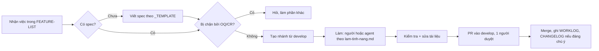

# WORKFLOW.md — Quy trình thực hiện dự án

| | |
|---|---|
| Phiên bản | 0.4 |
| Trạng thái | Nháp |
| Người phụ trách | Đức (đội trưởng) |
| Người duyệt | Cả nhóm |
| Cập nhật | 2026-11-27 |

Ai làm gì, theo thứ tự nào, đồng bộ lúc nào, từ giờ tới hạn nộp cuối. Mốc CP và file nộp theo `de-bai/README.md`, `de-bai/02-guide.md`, `de-bai/03-rubric.md` của BTC và slide kickoff; file này chỉ sắp việc của nhóm quanh các mốc đó. Mỗi mốc có cột "BTC kiểm": thiếu một dòng là mất điểm mốc đó.

## 1. Vai trò

| Người | Phần chính | Sở hữu tài liệu | Duyệt PR |
|---|---|---|---|
| **Đức** — đội trưởng | Phạm vi, nộp Form 1 và Form 2 (CP1–CP4), `canvas.md`, `spec.md` §0–§3, tổng hợp `evidence/`, slide, kịch bản demo, merge `develop` → `main` | `PROJECT-RULES`, `OPEN-QUESTIONS`, `CHANGE-MANAGEMENT`, `CHANGE-REQUESTS`, `FEATURE-LIST`, `WORKFLOW` | Bài nộp; PR không ai khác duyệt được |
| **Toàn** — agent | Lõi Roa (`codebase/`): prompt, công cụ, `generate` / `draft` / `ask`; nối model thật; eval, chi phí | `spec.md` §4–§9, `eval/`, `cost/`, `data/DATA_CARD.md`, ADR 0003 | `codebase/`, `eval/` |
| **Khương** — backend | FastAPI, DB Supabase, `proposal_service`, deploy Render | `ARCHITECTURE`, `DATABASE`, `API_SPEC`, `DEVELOPMENT`, `TEST-STRATEGY` | `backend/` |
| **Phúc** — frontend | Next.js, màn hình chuyến đi, đề xuất, lịch sử, góp ý, chat; deploy Vercel | Spec phần màn hình trong `docs/features/` | `frontend/` |

**Việc của cả nhóm, không giao riêng một người** (BTC yêu cầu, giám khảo hỏi bất kỳ ai):

- **Bằng chứng pain (OQ-21):** nguồn chính là **review công khai** (mỗi người nhận một phần đào: app, nền tảng, cách chọn mẫu, link + ngày xem); nguồn kiểm lại là **form khảo sát** nhóm đã tạo cho người ngoài nhóm điền (mỗi người mời người ngoài nhóm điền, không tự điền). Ngưỡng BTC: ≥1 nguồn đạt ngưỡng (đào review công khai, hoặc ≥20 khảo sát) + ≥5 trích dẫn nguyên văn, ẩn tên. Đức tổng hợp vào `evidence/summary.md`.
- **Kho quán hot** (`data/`, `trending_spots`): cả nhóm cùng thu, Toàn tổng hợp, Đức kiểm điều khoản (OQ-11).
- **Đọc câu thử trượt** sau mỗi lượt eval, chọn cải tiến.
- **Ai cũng chạy được** `python run.py eval`, `python run.py simulate` và giải thích được một câu thử trượt.
- **Ai cũng kể lại được** câu chuyện Pain → Impact → Giải pháp → Đánh giá → Chi phí và trả lời: vì sao chọn hình dạng này, lỗi nguy hiểm nhất là gì, chi phí / task thành công tính thế nào, phần mình làm là gì.

## 2. Nguyên tắc

1. **Lát cắt AI trước, web app sau.** BTC chấm lát cắt (một quyết định AI) qua `run.py`, không chấm độ hoành tráng của sản phẩm. Đến CP3, `codebase/` + eval được ưu tiên hơn web app (OQ-19, OQ-20).
2. **Contract trước, code sau.** `DATABASE.md` mục 3 (plan JSON, `ops`) và `API_SPEC.md` là thứ frontend, backend, agent cùng dựa vào. Chốt trước CP2; đổi sau đó là L3, báo cả nhóm (`CHANGE-MANAGEMENT.md`).
3. **Làm song song bằng dữ liệu giả.** Phúc dựng UI với JSON mẫu theo `API_SPEC.md`; Khương dựng API với plan mẫu; Toàn dựng Roa với công cụ trả dữ liệu ghi sẵn. Nối với nhau khi từng phần chạy được.
4. **Số thật, không sửa.** Chuẩn "đạt" chốt ở CP2; không bỏ câu thử trượt, không sửa `expected`, không sửa kết quả lượt đã chạy (R-63, R-64). Kết quả thấp mà trung thực vẫn đủ điểm.
5. **Câu hỏi mở thì hỏi ngay.** Ghi vào `OPEN-QUESTIONS.md`, nhắn nhóm; làm phần không bị chặn trong lúc chờ (R-02).
6. **Ghi log khi xong việc, không để cuối ngày.** Một dòng `WORKLOG.md` cho mỗi việc; việc có dùng AI thì thêm dòng `docs/ai-usage.md`.

## 3. Lịch theo mốc

**Nộp bài:**

- **Form 1 — đăng ký đội:** Đức nộp **trước 16:30 thứ Sáu 27/11**, dùng MSSV của Đức cho cả 4 mốc. Điền nhầm thì báo Lab Coach sửa, không nộp lại Form 1. Thứ tự nộp Form 1 quyết định xếp phòng chiều thứ Bảy.
- **Form 2 — nộp checkpoint:** **một link cho cả 4 mốc**; mỗi lần nộp chọn tên đội ở dropdown rồi chọn nhánh **CP1**, **CP2**, **CP3** hoặc **CP4**. Trước khi nộp, mở link repo (và link video nếu có) bằng **cửa sổ ẩn danh** để chắc không lỗi 404.
- Sau CP4 không nộp thêm form; repo khoá lúc 23:59 thứ Bảy 28/11.
- Phần chưa xong vẫn nộp đúng giờ và khai thật.

**4 điều kiện cứng xét giải** (Đức tick xác nhận trên Form 2, nhánh CP4):

1. Bản chạy thử gọi **AI thật** ở quyết định trung tâm (`generate`), không hardcode.
2. **Pain đạt ngưỡng:** ≥1 nguồn bằng chứng đạt ngưỡng + ≥5 trích dẫn trong `evidence/`.
3. **Bộ ≥20 câu thử** (≥5 khó, ≥2 từ chối / tấn công) + kết quả có % đạt trong `eval/`.
4. **Slide + video:** file `demo-slides.pdf` ở **gốc repo** + video dự phòng mở được ở cửa sổ ẩn danh.

**Lát cắt AI trước (OQ-20):** đến CP3, ưu tiên `codebase/` (lõi Roa chế độ `generate`) + eval. Web app (Vercel, Render, đề xuất, bỏ phiếu) làm sau, hoặc song song khi lát cắt AI đã chạy; Khương và Phúc làm web app chỉ khi phần việc BTC kiểm của mốc đó đã có người làm.

### Giai đoạn 0 — đến CP1 (17:00 thứ Sáu 27/11)

**BTC kiểm (Form 2 → CP1):** `TEAMS.md` đủ 4 thành viên, đội trưởng dòng 1, `python run.py check` không báo gì ở phần "Kiểm TEAMS.md" · track C + bài toán 1–2 câu (không có chữ AI) · lát cắt 1 câu · `canvas.md` 7 dòng · repo công khai mở được bằng cửa sổ ẩn danh.

| Người | Việc | Xong khi |
|---|---|---|
| Đức | Form 1 trước 16:30; `TEAMS.md`, repo công khai; duyệt `canvas.md` 7 dòng (bản nháp đã có); xác nhận các OQ đã chốt; chốt OQ-09 | Phần "Kiểm TEAMS.md" của `python run.py check` không báo gì; `main` có khung của nhóm; nộp Form 2 → CP1 |
| Cả nhóm | `spec.md` §1 (ai, việc gì, đang giải bằng gì, hỏng ở đâu); `evidence/hypothesis.md`; mỗi người nhận một phần đào review công khai + gửi form khảo sát cho người ngoài nhóm (OQ-21) | Mỗi người có nguồn review + cách chọn mẫu; form đã gửi đi |
| Cả nhóm | Đọc `AGENTS.md`, ADR 0001, ADR 0002, ADR 0004, spec đề xuất | Ai cũng nói lại được: phiếu chỉ ghi nhận, nhóm trưởng quyết |
| Toàn | Chọn 2–3 model ứng viên (OQ-01); thử gọi công cụ, tiếng Việt, JSON | Bảng so sánh ngắn trong OQ-01 |
| Khương, Phúc | Thu bằng chứng trước (review, form khảo sát); còn thời gian thì dựng khung `backend/`, `frontend/` (OQ-20) | Phần đào review của mình xong |

### Giai đoạn 1 — đến CP2 (19:30 thứ Sáu 27/11)

**BTC kiểm (Form 2 → CP2):** canvas cập nhật + 1–3 dòng "đã đổi gì so với CP1" · nguồn bằng chứng đang làm và đã đến đâu · `spec.md` §4 có sơ đồ (Input → lõi AI → chặn rủi ro → output) · `eval/benchmark.csv` ≥10 câu · `eval/metric_spec.yaml` · `data/DATA_CARD.md` bản đầu · chuẩn "đạt" bằng số trong `spec.md` §7 · `python run.py` đi hết luồng với AI giả.

Chốt "đạt" lúc 19:30: sau CP2 không sửa chuẩn đạt, metric (R-64).

| Người | Việc | Xong khi |
|---|---|---|
| Cả nhóm | 20 phút tổng hợp pain từ các cuộc hỏi / phần đào đã có → chốt lát cắt một câu + sơ đồ | Canvas dòng 5, `spec.md` §4 |
| Đức | `spec.md` §3 (giải pháp tương tự); `canvas.md` cập nhật + "đã đổi gì" | Có trong repo |
| Toàn | `spec.md` §4: hình dạng + lý do, công cụ (tên · input · output · tác động ra ngoài), chỗ chặn rủi ro, chỗ người duyệt, ≥3 nguyên tắc (bắt buộc G10); phần nào còn giả | Người ngoài nhóm nhìn sơ đồ kể lại được luồng |
| Đức + Toàn | `spec.md` §5: 4 lớp chỗ khó, ≥6 kịch bản, 2 kịch bản tấn công | Có ít nhất một kịch bản làm nhóm sợ khi demo |
| Đức + Toàn | `eval/benchmark.csv` ≥10 câu (≥1/3 có `source` từ người dùng / data thật), `eval/metric_spec.yaml` ≥3 metric, `spec.md` §7 chuẩn "đạt" có điều kiện cứng | `python run.py check` qua; commit trước 19:30 |
| Khương (chấm độc lập) | Chấm thử 5 output theo `metric_spec.yaml` cùng Toàn | Khớp ≥4/5, ghi `eval/README.md` |
| Toàn | `codebase/` khung Roa chạy chế độ giả hết luồng; `data/DATA_CARD.md` bản đầu | `python run.py` không lỗi |
| Toàn | Trước khi rời lớp: lấy key, gọi thử được 1 câu | `python run.py eval --try` có token > 0 |
| Khương | Migration các bảng `DATABASE.md`; API chuyến đi, tham gia, plan, phiên bản | Gọi được qua `/docs` |
| Phúc | UI: tạo chuyến đi, tham gia, xem plan theo ngày, lịch sử phiên bản (dữ liệu giả) | Chạy được local hoặc Vercel |
| Cả nhóm | Duyệt `DATABASE.md`, `API_SPEC.md` lên 1.0 | Hai file trạng thái "Đã duyệt" |

### Giai đoạn 2 — đêm thứ Sáu đến CP3 (10:00 thứ Bảy 28/11)

**BTC kiểm (Form 2 → CP3):** bằng chứng pain đạt ngưỡng ≥1 nguồn + ≥5 trích dẫn nguyên văn (ẩn tên), `evidence/summary.md` · bộ câu thử 20–30 câu (≥5 `kho`, ≥2 `tu_choi`) · video 30 giây bản chạy thử gọi AI thật · kết quả lượt 1 (x/N) + run ID · `spec.md` §0–§7 · phần chưa xong.

Bắt buộc: lời gọi AI thật ở quyết định trung tâm (`generate`). Web app chưa xong vẫn nộp CP3 được (OQ-20).

| Người | Việc | Xong khi |
|---|---|---|
| Toàn | Nối model thật; công cụ Google + kho quán hot; cài chỗ chặn rủi ro ở §4 | `eval --try` có token > 0 |
| Toàn + Đức | Mở rộng bộ câu thử lên 20–30 câu (chỉ thêm, không sửa đáp án) | `python run.py check` qua |
| Cả nhóm (sáng thứ Bảy) | Chốt bằng chứng + bảng impact `spec.md` §2; chạy lượt 1 cùng nhau: `python run.py eval` → chấm cột `pass` → `score` | `eval/run-1.csv` + kết quả `score` |
| Toàn | `python run.py simulate` thử 10 phiên để kiểm khung | `cost/simulate-1.csv` |
| Đức | `evidence/summary.md` (số chính + giả thuyết đúng / sai / phải đổi); `spec.md` §0–§2; video 30 giây (YouTube không công khai hoặc Drive, mở thử bằng cửa sổ ẩn danh) | Đủ theo danh sách BTC kiểm |
| Khương | Sau khi lát cắt AI chạy: `plan_service` (duyệt v1), `proposal_service` (tạo, ghi phiếu, nhóm trưởng áp dụng / đóng, stale, hạn tuỳ chọn) + test R-60; `agent_service` nối lõi Roa | AC-1 – AC-10 (T) qua |
| Phúc | UI tab "Đề xuất", chế độ sửa, form góp ý, chat; nối API thật | Lát cắt demo chạy được |
| Cả nhóm | Thu quán hot vào `data/` (phạm vi điểm đến theo OQ-11) | `trending_spots` có dữ liệu |

### Giai đoạn 3 — CP3 đến CP4 (14:30 thứ Bảy 28/11)

**BTC kiểm (Form 2 → CP4):** phòng demo + link repo · lượt 1 → lượt 2 trong `eval/report.md` · chi phí / task thành công kèm tên model (`python run.py simulate --rate-from eval/run-2.csv`, ≥50 phiên) · **`demo-slides.pdf` ở gốc repo** · link video demo dự phòng · tick 4 điều kiện cứng xét giải (mục 3) · phần chưa xong.

| Người | Việc | Xong khi |
|---|---|---|
| Cả nhóm (10:00) | Ngồi chung đọc câu trượt lượt 1, gom nhóm lỗi có tên, chọn một nhóm lỗi đau nhất | Ghi trong `eval/report.md` |
| Toàn | Một lần cải tiến nhắm nhóm lỗi đó → lượt 2 trên cùng bộ câu thử | `eval/run-2.csv` + `score` |
| Toàn | `eval/report.md` (% lượt 1, lượt 2, ≥3 lỗi có input · output · vì sao sai); `eval/README.md` hồ sơ đánh giá một trang | Người ngoài nhóm đọc hiểu được |
| Toàn + Khương | `cost/personas.yaml` ≥3 kiểu người dùng; `python run.py simulate --rate-from eval/run-2.csv` ≥50 phiên; `cost/cost-estimate.md` 3 kịch bản, ≥2 mức model, giá có link + ngày xem, so với impact | Mọi số truy được về file mô phỏng hoặc nguồn |
| Đức | `spec.md` §8–§9; slide 8 trang theo guide 5.1 (mỗi trang ≥1 số có nguồn), xuất **`demo-slides.pdf` đặt ở gốc repo**; video dự phòng (mở thử bằng cửa sổ ẩn danh); `docs/ai-usage.md`; mục "Dùng AI vào việc gì" trong README | Đủ theo danh sách BTC kiểm |
| Khương | Sửa lỗi tích hợp; khôi phục phiên bản; ổn định deploy | Kịch bản `TEST-STRATEGY.md` mục 3 qua bước 1–9 |
| Phúc | Hoàn thiện UI, điện thoại, trạng thái lỗi/đang tải | Demo trên điện thoại được |
| Mỗi người (bonus) | 1 người ngoài nhóm dùng thử theo 5 nhịp (guide 4.3) → `validation/log.md` | ≥2 người, rút ra ≥1 thay đổi |
| Đức | Merge `develop` → `main`, đóng băng tính năng lúc 13:30; nộp Form 2 → CP4, tick 4 điều kiện cứng | Bản `main` chạy kịch bản demo; `demo-slides.pdf` có trên `main` |

### Demo (14:30–18:00) và hạn cuối (23:59 thứ Bảy 28/11)

- 30 phút trước demo: đánh thức Render; mở sẵn 4 trình duyệt đã tham gia chuyến đi mẫu; mở sẵn video dự phòng.
- Demo mỗi đội 9 phút, bấm giờ cứng: 5 phút pitch + demo AI, 3 phút thử ca khó và hỏi đáp. 1 trường hợp thường + 1 trường hợp khó (ví dụ yêu cầu không xếp được, Roa nói rõ vì sao); sẵn sàng chạy câu thử lạ giám khảo đưa; mỗi người nói ≥1 phần.
- Lỗi mạng hoặc API quá 30 giây: bật ngay video dự phòng.
- Sau vòng demo, Đức điền các form chấm chéo theo hướng dẫn của BTC tại phòng.
- Sau CP4: được sửa code, báo cáo, slide; mọi thay đổi ghi `spec.md` §10 (giờ · đổi gì · vì sao). Chạy thêm thì ghi thành lượt mới (`eval/run-3.csv`). Không sửa chuẩn "đạt", câu thử, số liệu bằng chứng, kết quả lượt đã chạy.
- Mỗi người viết `reflection/<ten-khong-dau>.md` trước 23:59: vai trò và phần mình làm · AI hỗ trợ thế nào · một bài học từ một câu thử trượt của nhóm.

## 4. Đồng bộ

| Khi | Việc | Ai | Thời lượng |
|---|---|---|---|
| Đầu mỗi buổi | Mỗi người: buổi trước xong gì, buổi này làm gì, bị chặn gì; chốt OQ đến hạn | Cả nhóm | 10 phút |
| Mỗi ~3 giờ | Ghép thử: frontend gọi backend thật, backend gọi Roa thật | Phúc, Khương, Toàn | 15 phút |
| 15 phút trước mỗi CP | Cả nhóm đi lại câu chuyện Pain → Impact → Giải pháp → Đánh giá → Chi phí; đối chiếu dòng "BTC kiểm" của mốc | Cả nhóm | 15 phút |
| 1 giờ trước CP3, CP4 | Đức chạy kịch bản demo trên `develop`; quyết cắt gì | Đức + người liên quan | 20 phút |
| Cuối mỗi buổi | Kiểm `WORKLOG.md`, `docs/ai-usage.md` đủ dòng | Đức | 5 phút |

Kênh: nhóm chat cho việc gấp; quyết định phải ghi vào `OPEN-QUESTIONS.md` hoặc ADR, không chỉ để trong chat.

## 5. Vòng làm một việc

## 6. Khi trễ

Thứ tự cắt (cắt từ dưới lên): bình chọn tự do → bản đồ → `draft` của Roa (nhóm trưởng tự sửa) → polling (bấm tải lại) → khôi phục phiên bản (vẫn xem lịch sử) → deploy (demo chạy local). **Không cắt:** lát cắt `generate` gọi AI thật, và mọi thứ BTC kiểm: bằng chứng pain, bộ câu thử + lượt 1 → lượt 2, mô phỏng chi phí, `demo-slides.pdf`, video. Cắt web app trước khi cắt các phần này (OQ-20); trong web app, giữ đến cuối: v1 do nhóm trưởng duyệt, đề xuất + bỏ phiếu + nhóm trưởng áp dụng + lịch sử, hỏi Roa.

## Lịch sử thay đổi

| Phiên bản | Ngày | Người sửa | Nội dung | Căn cứ |
|---|---|---|---|---|
| 0.1 | 2026-11-27 | Đức | Bản đầu: vai trò, lịch theo CP1–CP4, đồng bộ, thứ tự cắt | Họp nhóm 27/11 |
| 0.2 | 2026-11-27 | Khương | Bỏ nhật ký buổi; thêm "BTC kiểm" mỗi mốc, việc của cả nhóm (bằng chứng, đọc câu trượt), chấm thử 5 output, video 30 giây, lượt 2, chi phí, slide, reflection; đi lại câu chuyện trước mỗi CP | Đối chiếu `README.md`, `02-guide.md`, `03-rubric.md` của BTC |
| 0.3 | 2026-11-27 | Khương | Nộp qua Form 1 (trước 16:30) và Form 2 (một link, chọn nhánh CP1–CP4); 4 điều kiện cứng tick ở CP4; `demo-slides.pdf` ở gốc repo + video mở được ẩn danh; lát cắt AI trước (OQ-20); bằng chứng: review công khai + form khảo sát (OQ-21); bỏ các việc chốt OQ đã xong; `proposal_service` theo ADR 0004; giờ demo, video khi lỗi >30 giây; CP1 chỉ cần phần "Kiểm TEAMS.md" của `check` không báo gì | Slide kickoff, OQ-20, OQ-21, ADR 0004 |
| 0.4 | 2026-11-27 | Khương | Kho quán hot không gắn Đà Lạt | OQ-09 |
