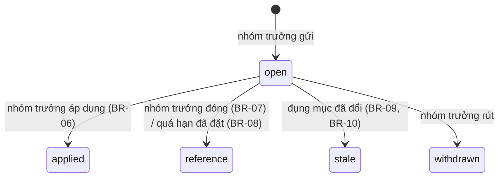

# Đề xuất sửa plan, bỏ phiếu và lịch sử phiên bản

| | |
|---|---|
| Phiên bản | 0.2 |
| Trạng thái | Nháp |
| Người phụ trách | Khương (backend), Phúc (frontend) |
| Người duyệt | Đức |
| Cập nhật | 2026-11-27 |
| Nhánh | `feat/de-xuat-va-bo-phieu` |

## 1. Bối cảnh

Nhóm đông người cùng sửa lịch trình dễ chồng chéo và không có bản chốt. Nhóm đã quyết (ADR 0002, ADR 0004): chỉ nhóm trưởng sửa plan, mỗi lần sửa là một đề xuất; cả nhóm bỏ phiếu để ghi lại ý kiến, nhóm trưởng quyết áp dụng hay đóng; thành viên góp ý qua form và hỏi Roa. Đây là phần web app của demo: v1 → đề xuất → bỏ phiếu → nhóm trưởng áp dụng → v2 → xem lịch sử. Lát cắt AI nộp BTC là `generate` (OQ-19), không nằm trong spec này.

## 2. User story

- Là **nhóm trưởng**, tôi muốn sửa lịch trình (tự sửa hoặc nhờ Roa) rồi gửi cho cả nhóm biểu quyết, để biết ý mọi người trước khi áp dụng.
- Là **thành viên**, tôi muốn thấy đề xuất đổi gì so với bản hiện tại và bỏ phiếu, để có tiếng nói mà không phải sửa trực tiếp.
- Là **thành viên**, tôi muốn gửi góp ý cho nhóm trưởng gắn với một ngày hoặc một mục, để ý kiến không bị trôi trong chat.
- Là **mọi người**, tôi muốn xem lịch sử phiên bản và so hai phiên bản, để biết plan đã đổi gì, ai đề xuất, kết quả phiếu lúc áp dụng.
- Là **nhóm trưởng**, tôi muốn quay lại một phiên bản cũ qua một đề xuất, để sửa sai mà không mất lịch sử.

## 3. Phạm vi

**Trong phạm vi:**

- Chế độ sửa của nhóm trưởng: thêm, sửa giờ / chi phí / ghi chú, xoá, chuyển mục giữa các ngày trên bản nháp cục bộ; xem diff; gửi đề xuất.
- Nhờ Roa soạn đề xuất (`proposals/draft`).
- Tab "Đề xuất": đang mở và đã đóng; thẻ đề xuất có diff, thanh phiếu (đạt / chưa đạt đa số, tên người bỏ), nút Đồng ý / Không đồng ý, cảnh báo.
- Nhóm trưởng áp dụng hoặc đóng đề xuất; trạng thái `reference`, `stale`, `withdrawn`; hạn tuỳ chọn, kiểm lười.
- Form góp ý (thành viên) và hộp góp ý (nhóm trưởng): chuyển thành đề xuất, ghi nhận, từ chối.
- Lịch sử phiên bản: danh sách, xem phiên bản cũ (chỉ đọc), so sánh, khôi phục (qua đề xuất).

**Ngoài phạm vi:**

- Bình chọn tự do giữa nhiều phương án (OQ-05).
- Chuyển quyền nhóm trưởng.
- Thông báo đẩy, email.
- Kéo thả trên bản đồ.

## 4. Quy tắc nghiệp vụ

| Mã | Quy tắc |
|---|---|
| BR-01 | Chỉ nhóm trưởng tạo, áp dụng, đóng, rút đề xuất và xử lý góp ý. Thành viên gọi các API đó nhận 403 `not_leader`. |
| BR-02 | Mọi thay đổi plan sau v1 đi qua đề xuất. Không có API sửa plan trực tiếp. |
| BR-03 | Đề xuất lưu `base_version` và `ops`; `ops` phải áp dụng được trên `base_version` lúc tạo. |
| BR-04 | Ngưỡng tham khảo: `required_votes = floor(n/2) + 1`, `n` là số thành viên (gồm nhóm trưởng) lúc tạo đề xuất. Nhóm trưởng tự có một phiếu đồng ý khi tạo. `agree ≥ required_votes` thì hiện "Đạt đa số", ngược lại "Chưa đạt đa số". Phiếu không tự gây ra áp dụng hay đóng (ADR 0004). |
| BR-05 | Mỗi thành viên một phiếu mỗi đề xuất; đổi ý được khi đề xuất còn mở. Phiếu công khai tên người bỏ. |
| BR-06 | Nhóm trưởng chọn "Áp dụng" → tạo phiên bản mới, đề xuất `applied`, lưu kết quả phiếu lúc đó vào `votes_at_decision`. Chưa đạt đa số vẫn áp dụng được; frontend hỏi xác nhận trước. |
| BR-07 | Nhóm trưởng chọn "Đóng" → đề xuất `reference` (`close_reason = leader_closed`), lưu `votes_at_decision`, không tạo phiên bản. |
| BR-08 | Hạn là tuỳ chọn: nhóm trưởng đặt `expires_at` khi tạo, không đặt thì không hết hạn. Quá `expires_at` mà nhóm trưởng chưa quyết → `reference` (`close_reason = expired`). Kiểm khi đọc, bỏ phiếu hoặc áp dụng. |
| BR-09 | Khi áp dụng, nếu từ `base_version` tới hiện tại đã có thay đổi đụng cùng mục với `ops` → `stale`, không áp dụng. Không đụng → áp dụng `ops` lên bản hiện tại. |
| BR-10 | Sau mỗi lần áp dụng, các đề xuất mở khác đụng cùng mục chuyển `stale`. |
| BR-11 | Đề xuất đã đóng (`applied`, `reference`, `stale`, `withdrawn`) không nhận phiếu, không đổi trạng thái, vẫn hiện để tham khảo. |
| BR-12 | Khôi phục = đề xuất `kind = revert` với `target_version`; nhóm trưởng áp dụng như mọi đề xuất, tạo phiên bản mới có plan bằng `target_version`. Phiên bản hiện tại khác `base_version` → `stale`. |
| BR-13 | Phiên bản không bị sửa hay xoá (I1). |
| BR-14 | Góp ý không bao giờ đổi plan. Nhóm trưởng chuyển góp ý thành đề xuất (`converted`), ghi nhận (`noted`) hoặc từ chối (`declined`, nên kèm ghi chú). |
| BR-15 | Thành viên chỉ thấy góp ý của mình; nhóm trưởng thấy tất cả. |
| BR-16 | Roa không tạo đề xuất. `draft` chỉ trả `ops` nháp; nhóm trưởng gửi mới thành đề xuất (R-31). |
| BR-17 | Plan v1: `generate` trả bản nháp, không lưu. Nhóm trưởng duyệt (`POST /trips/{id}/plan`) thì mới thành v1, không qua bỏ phiếu. Đã có v1 thì không duyệt v1 lần nữa. |

## 5. Trạng thái

Góp ý: `new` → `converted` | `noted` | `declined`.

## 6. Tiêu chí nghiệm thu

Nhóm 4 người: Đức (nhóm trưởng), Phúc, Toàn, Khương. Plan đang ở v12. Ngưỡng tham khảo 3.

| Mã | Given | When | Then |
|---|---|---|---|
| AC-1 | Phúc là thành viên | Phúc gọi `POST /proposals` | 403 `not_leader`, không có đề xuất mới |
| AC-2 | Đức sửa trên bản nháp: chuyển Dinh Bảo Đại III sang sáng ngày 2 | Đức gửi đề xuất | Đề xuất #7 `open`, `base_version = 12`, phiếu 1/3, mọi thành viên thấy thẻ có diff trong ≤ 5 giây |
| AC-3 | #7 có 2 phiếu đồng ý (Đức, Toàn) | Phúc bỏ đồng ý | #7 vẫn `open`, thanh phiếu hiện "Đạt đa số (3/4)" và tên 3 người; không có phiên bản mới |
| AC-3b | #7 như AC-3 | Đức bấm "Áp dụng" | Tạo v13, #7 `applied`, lịch sử có dòng "Áp dụng đề xuất #7 (3/4 đồng ý)" |
| AC-4 | #7 có 1 đồng ý, Phúc và Toàn không đồng ý | Đức bấm "Đóng" | #7 `reference`, `close_reason = leader_closed`, `votes_at_decision` ghi 1 đồng ý / 2 không; không có phiên bản mới |
| AC-4b | #7 như AC-4 | Đức bấm "Áp dụng" và xác nhận | Tạo v13; lịch sử ghi "Áp dụng đề xuất #7 (1/4 đồng ý, chưa đạt đa số)" |
| AC-5 | Đức đặt hạn cho #7; #7 `open`, quá `expires_at` | Ai đó mở tab "Đề xuất" | #7 hiện `reference` (`expired`). Đề xuất không đặt hạn thì vẫn `open` |
| AC-6 | #7 và #8 cùng mở, cùng đụng mục `itm_dinh3`; #7 vừa áp dụng | — | #8 `stale`, nút bỏ phiếu ẩn |
| AC-7 | #8 mở dựa trên v12, chỉ đụng mục ngày 3; #7 (ngày 1) đã áp dụng thành v13 | Đức áp dụng #8 | Tạo v14 = v13 + ops của #8 |
| AC-8 | Đức bấm "Áp dụng" hai lần liền (hai request cùng lúc) | — | Chỉ một phiên bản mới được tạo; request sau nhận 410 `proposal_closed` |
| AC-9 | Phúc đã bỏ đồng ý cho #7 | Phúc đổi thành không đồng ý | Số phiếu cập nhật, không đếm trùng |
| AC-10 | #7 `applied` | Toàn bỏ phiếu | 410 `proposal_closed` |
| AC-11 | Phúc gửi góp ý "đổi bữa trưa ngày 2 sang quán chay" | Đức mở hộp góp ý, chọn "Tạo đề xuất" | Chế độ sửa mở, điền sẵn nội dung; đề xuất gửi đi có `suggestion_id`, góp ý `converted` |
| AC-12 | Đức đang ở v14 | Đức chọn khôi phục v9 rồi áp dụng đề xuất đó | Tạo v15 có plan bằng v9; v9–v14 vẫn còn |
| AC-13 | Đức nhờ Roa "đưa Dinh Bảo Đại III sang sáng ngày 2" | Roa trả kết quả | Có `ops` + diff, chưa có đề xuất nào, chưa có phiên bản mới |
| AC-14 | Bất kỳ | Xem v9 trong lịch sử | Plan v9 chỉ đọc, có nút "So với hiện tại" |

### 6.1 Kiểm chứng

| AC | Cách kiểm | Ở đâu |
|---|---|---|
| AC-1, AC-3, AC-3b, AC-4, AC-4b, AC-5, AC-6, AC-7, AC-9, AC-10, AC-12 | T | `backend/tests/test_proposal_service.py` |
| AC-8 | T (hai phiên DB song song) | `backend/tests/test_apply_concurrency.py` |
| AC-13 | T (model giả) + E | `backend/tests/test_agent_draft.py`, demo |
| AC-2, AC-11, AC-14 | E | Kiểm tay trên bản preview Vercel, 2 trình duyệt |

## 7. Thiết kế

- **Màn hình:** theo bản thiết kế nhóm đã duyệt (lịch sử phiên bản ở cột trái, tab "Đề xuất" ở cột phải, thẻ đề xuất có thanh phiếu và diff, chế độ sửa có thanh trên "Đang sửa từ v12").
- **API:** `docs/API_SPEC.md` mục 3, 4, 5.
- **Dữ liệu:** `plan_versions`, `proposals`, `votes`, `suggestions`, `trip_events` (`docs/DATABASE.md`); `ops` mục 3.2.
- **Agent:** chế độ `draft` (`ARCHITECTURE.md` mục 3.3).
- **Frontend sinh `ops`:** chế độ sửa giữ bản nháp cục bộ và ghi lại thao tác người dùng thành `ops`; gửi kèm `base_version`.

## 8. Kế hoạch

| Bước | Việc | Người | Xong khi |
|---|---|---|---|
| 1 | Model + migration: `plan_versions`, `proposals`, `votes`, `suggestions`, `trip_events` | Khương | `alembic upgrade head` chạy trên Supabase |
| 2 | `plan_service`: áp dụng `ops`, diff, kiểm plan | Khương | Test áp dụng 4 loại `op` qua |
| 3 | `proposal_service`: tạo, bỏ phiếu, áp dụng, đóng, stale, hết hạn | Khương | AC-3 – AC-10, AC-12 qua (T) |
| 4 | API mục 4, 5 + `updates` | Khương | OpenAPI khớp `API_SPEC.md` |
| 5 | `draft` của Roa | Toàn | AC-13 |
| 6 | UI tab "Đề xuất", thẻ đề xuất, thanh phiếu | Phúc | AC-2 (E) |
| 7 | UI chế độ sửa + sinh `ops` + diff | Phúc | Gửi được đề xuất từ UI |
| 8 | UI lịch sử phiên bản, so sánh, khôi phục | Phúc | AC-14 (E) |
| 9 | UI form góp ý, hộp góp ý | Phúc | AC-11 (E) |
| 10 | Chạy thử lát cắt demo với 4 trình duyệt | Đức | Không lỗi trên bản Vercel + Render |

## 9. Truy vết

| Spec | Code | Test |
|---|---|---|
| BR-01 | `app/services/proposal_service.py`, `suggestion_service.py` | AC-1 |
| BR-04, BR-05 | `proposal_service.cast_vote` | AC-3, AC-9 |
| BR-06 – BR-08 | `proposal_service.apply`, `proposal_service.close` | AC-3b, AC-4, AC-4b, AC-5 |
| BR-09, BR-10 | `proposal_service.apply`, `plan_service.touched_items` | AC-6, AC-7 |
| BR-12 | `proposal_service.apply` (revert) | AC-12 |
| BR-17 | `plan_service.approve_initial` | Test duyệt v1 |
| BR-14, BR-15 | `suggestion_service` | AC-11 |
| BR-16 | `agent_service.draft` | AC-13 |

(Điền đường dẫn thật khi có code.)

## 10. Xung đột và câu hỏi còn mở

| Mã | Câu hỏi | Chặn phần nào |
|---|---|---|
| OQ-04 | Mở lại đề xuất `reference` | Nút trên thẻ đề xuất đã đóng |

Đã chốt ở v0.2: OQ-02, OQ-03, OQ-13, OQ-17 (ADR 0004), OQ-06 (link mời + token). Phần không bị chặn: mọi bước trừ nút "tạo lại từ đề xuất này".

## 11. Rủi ro

| Rủi ro | Ảnh hưởng | Cách giảm |
|---|---|---|
| Sinh `ops` từ thao tác UI phức tạp | Chậm phần UI | Chỉ hỗ trợ 4 loại `op`; chuyển mục bằng menu "Chuyển sang ngày…" thay vì kéo thả |
| Nhiều đề xuất `stale` khi demo | Demo rối | Kịch bản demo chỉ mở 1–2 đề xuất một lúc |
| Polling 5 giây trên Render ngủ | Lần đầu chậm | Gọi `/health` trước demo |
| Nhóm trưởng áp dụng ngược ý đa số | Thành viên thấy không có tiếng nói | Phiếu công khai, hỏi xác nhận khi chưa đạt đa số, lịch sử ghi kết quả phiếu |

## Lịch sử thay đổi

| Phiên bản | Ngày | Người sửa | Nội dung | Căn cứ |
|---|---|---|---|---|
| 0.1 | 2026-11-27 | Khương | Bản đầu: BR-01 – BR-17, AC-1 – AC-14 | ADR 0002 |
| 0.2 | 2026-11-27 | Khương | Phiếu chỉ để ghi nhận, nhóm trưởng áp dụng / đóng (BR-04, 06, 07); hạn tuỳ chọn (BR-08); v1 do nhóm trưởng duyệt (BR-17); sửa AC-3, 4, 5, 7, 8, 12, thêm AC-3b, AC-4b | ADR 0004 |
