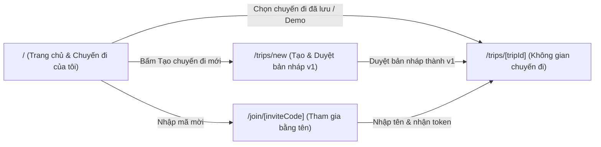

# Giao diện web Partaway (Frontend Screens)

| | |
|---|---|
| Phiên bản | 0.2 |
| Trạng thái | Nháp |
| Người phụ trách | Phúc (frontend) |
| Người duyệt | Đức, Khương |
| Cập nhật | 2026-11-27 |
| Nhánh | `feat/frontend-screens` |

## 1. Bối cảnh

Theo `ARCHITECTURE.md` mục 3.1, `docs/API_SPEC.md` và `docs/OPEN-QUESTIONS.md` (`OQ-06`, `OQ-13`, `OQ-14`, `OQ-19`), Partaway là web app giúp nhóm bạn đông người cùng xem, góp ý, bỏ phiếu và hỏi trợ lý AI **Roa** về lịch trình du lịch (thành phố demo: Đà Lạt). Giao diện sử dụng xác thực bằng **link mời + tên hiển thị + token** (`OQ-06`), không có màn hình đăng nhập/đăng ký tài khoản. Toàn bộ con số tổng chi phí, số phiếu, ngưỡng đa số và trạng thái đề xuất lấy trực tiếp từ backend (`R-41`).

## 2. User story

- Là **nhóm trưởng**, tôi muốn tạo chuyến đi mới, xem bản nháp Roa soạn (hoặc lý do không xếp được), tạo lại nếu chưa ưng và duyệt thành v1, để cả nhóm có lịch trình khởi đầu chuẩn xác.
- Là **nhóm trưởng**, tôi muốn bật chế độ sửa ngay trên lịch trình (hoặc nhờ Roa soạn `ops`), xem diff và gửi thành đề xuất, để cả nhóm biểu quyết trước khi áp dụng v2.
- Là **nhóm trưởng**, tôi muốn xem hộp góp ý của thành viên, chuyển góp ý thành đề xuất hoặc ghi nhận/từ chối, và quyết định áp dụng/đóng/rút đề xuất.
- Là **thành viên**, tôi muốn mở link mời, nhập tên hiển thị để vào thẳng không gian chuyến đi mà không cần tạo tài khoản.
- Là **thành viên**, tôi muốn xem lịch trình theo ngày, bỏ phiếu công khai cho đề xuất, gửi góp ý gắn ngày/mục, xem lịch sử phiên bản và hỏi Roa trên khung chat chung của nhóm.

## 3. Phạm vi

**Trong phạm vi (4 route MVP):**

- `/` — Trang chủ: giới thiệu ngắn gọn, mở nhanh chuyến đi mẫu Đà Lạt 3N2Đ, nhập mã mời tham gia, danh sách chuyến đi đã lưu trong trình duyệt.
- `/trips/new` — Tạo chuyến đi mới & duyệt bản nháp v1: điền thông tin chuyến đi, gọi Roa soạn bản nháp (`generate`), xử lý trạng thái `infeasible`, tạo lại bản nháp hoặc duyệt thành v1.
- `/join/[inviteCode]` — Tham gia chuyến đi bằng link mời: xem trước thông tin chuyến đi, nhập tên hiển thị, lưu token vào `localStorage` và chuyển vào không gian chuyến đi.
- `/trips/[tripId]` — Không gian chuyến đi chính: bố cục 3 cột trên desktop và thanh tab trên mobile (`375px`), gồm thông tin/lịch sử phiên bản, timeline lịch trình + chế độ sửa của nhóm trưởng, hộp góp ý/form góp ý, tab Đề xuất (bỏ phiếu & áp dụng/đóng/rút), tab Trò chuyện chung với Roa, cập nhật polling mỗi 5 giây.

**Ngoài phạm vi (không làm lần này):**

- Đăng nhập / đăng ký tài khoản (`/authentication`), mật khẩu (`OQ-06`, P2).
- Kéo thả trực tiếp trên bản đồ hoặc trên timeline (`docs/features/de-xuat-va-bo-phieu.md`).
- Bình chọn tự do giữa nhiều phương án (`OQ-05`).
- Mở lại đề xuất `reference` (`OQ-04`).
- Streaming câu trả lời của Roa (`docs/API_SPEC.md` mục 6).

## 4. Quy tắc nghiệp vụ

| Mã | Quy tắc |
|---|---|
| BR-FE-01 | Không có tài khoản: phiên làm việc của từng chuyến đi lưu trong `localStorage` (`partaway:v1:sessions`) gồm `tripId`, `token`, `memberId`, `displayName`, `role`, `inviteCode`. |
| BR-FE-02 | Mọi yêu cầu API đi qua `frontend/lib/api.ts` kèm `Authorization: Bearer <token>` trừ các endpoint tạo/mời (`R-40`). Khi `NEXT_PUBLIC_USE_MOCK=true` hoặc `tripId === "demo-dalat-3n2d"`, sử dụng dữ liệu mẫu có trạng thái trong bộ nhớ. |
| BR-FE-03 | Frontend không tự tính tổng chi phí/người, tổng thời gian di chuyển, số phiếu, ngưỡng đa số hay trạng thái đề xuất; hiển thị đúng giá trị từ `computed` và `votes` của backend (`R-41`). |
| BR-FE-04 | Ẩn toàn bộ nút chỉ nhóm trưởng dùng được (duyệt v1, bật chế độ sửa, nhờ Roa soạn đề xuất, gửi/áp dụng/đóng/rút đề xuất, xử lý góp ý, khôi phục phiên bản) khi `me.role !== "leader"` (`R-42`). |
| BR-FE-05 | Khi nhóm trưởng sửa trên giao diện, thao tác chỉ ghi tạm vào danh sách `ops` cục bộ (`add_item`, `update_item`, `remove_item`, `move_item`) trên `base_version` đang xem; không sửa trực tiếp plan trên server. Chuyển mục giữa các ngày bằng `<select>` thay cho kéo thả. |
| BR-FE-06 | Khi nhóm trưởng bấm "Áp dụng" một đề xuất chưa đạt đa số (`!proposal.votes.majority`), giao diện bắt buộc mở hộp thoại xác nhận `<dialog>` nêu rõ số phiếu hiện tại trước khi gọi API (`BR-06`). |
| BR-FE-07 | Khi `generate` trả `status === "infeasible"`, hiển thị rõ danh sách `reasons` và cho phép chỉnh lại yêu cầu; không tạo bản v1 giả. |
| BR-FE-08 | Trong tab Trò chuyện, nếu tin nhắn của Roa có `suggest_feedback: true`, hiển thị nút "Gửi góp ý cho nhóm trưởng" để mở form góp ý đã điền sẵn nội dung (`R-32`). |
| BR-FE-09 | Polling `GET /trips/{id}/updates?since=` chạy mỗi 5 giây chỉ khi tab trình duyệt đang hiển thị (`document.visibilityState === "visible"`) (`OQ-10`). |
| BR-FE-10 | Mọi thao tác gọi backend hiển thị trạng thái đang tải (kết thúc bằng `…`), vô hiệu hoá nút bấm để chống gửi đúp, và hiện lỗi `error.message` trong vùng `aria-live="polite"` (`R-43`). Giao diện dùng được ở độ rộng `375px` (`R-44`). |

## 5. Sơ đồ điều hướng



## 6. Tiêu chí nghiệm thu

| Mã | Given | When | Then |
|---|---|---|---|
| AC-FE-1 | Người dùng mới mở `/` | Trang tải xong | Hiện phần giới thiệu, nút "Tạo chuyến đi mới", nút "Mở chuyến đi mẫu Đà Lạt 3N2Đ", ô nhập mã mời và trạng thái rỗng khi chưa có chuyến đi lưu |
| AC-FE-2 | Nhóm trưởng ở `/trips/new` nhập ngân sách không khả thi (vd `< 600.000đ` ở chế độ mẫu) | Bấm "Tạo bản nháp với Roa" | Hiện khối cảnh báo `infeasible` kèm danh sách lý do và nút "Chỉnh lại yêu cầu", không lưu v1 |
| AC-FE-3 | Nhóm trưởng ở `/trips/new` nhận bản nháp hợp lệ từ Roa | Bấm "Duyệt thành bản v1" | Gọi `POST /trips/{id}/plan`, lưu token nhóm trưởng và chuyển sang `/trips/{id}` |
| AC-FE-4 | Thành viên mở `/join/[inviteCode]` | Nhập tên hiển thị hợp lệ và bấm "Tham gia chuyến đi" | Nhận token, lưu `localStorage` và chuyển vào `/trips/{id}`. Nếu trùng tên (`409 name_taken`), hiện lỗi ngay cạnh ô nhập |
| AC-FE-5 | Thành viên (`role = "member"`) mở `/trips/[tripId]` | Xem timeline, đề xuất, góp ý, lịch sử | Toàn bộ nút sửa, tạo/áp dụng/đóng/rút đề xuất, xử lý góp ý và khôi phục bị ẩn (`R-42`) |
| AC-FE-6 | Nhóm trưởng bật chế độ sửa ở `/trips/[tripId]` | Sửa giờ/chi phí hoặc chuyển ngày một mục và gửi đề xuất | Sinh đúng mảng `ops`, tạo đề xuất mới và hiển thị trong tab Đề xuất với thanh phiếu công khai |
| AC-FE-7 | Đề xuất đang mở chưa đạt đa số | Nhóm trưởng bấm "Áp dụng" | Mở `<dialog>` xác nhận rõ số phiếu đồng ý; bấm "Áp dụng ngay" mới gọi `apply`, bấm "Huỷ" không đổi dữ liệu |
| AC-FE-8 | Thành viên hỏi Roa câu mang ý sửa plan (`suggest_feedback: true`) | Roa trả lời xong | Hiện nút "Gửi góp ý cho nhóm trưởng" điền sẵn nội dung câu hỏi vào form góp ý |
| AC-FE-9 | Người dùng mở phiên bản cũ trong Lịch sử | Bấm xem v1 và bấm "So với hiện tại" | Lịch trình chuyển sang chế độ chỉ đọc bản v1 và mở modal diff giữa hai phiên bản |
| AC-FE-10 | Người dùng mở `/trips/[tripId]` trên màn hình `375px` | Chuyển qua lại giữa `Lịch trình`, `Đề xuất`, `Trò chuyện` và mở `Thông tin` | Không tràn ngang, nút bấm ≥ 44–48px, các vùng nội dung đọc rõ ràng |

### 6.1 Kiểm chứng

| AC | Cách kiểm | Ở đâu |
|---|---|---|
| AC-FE-1 – AC-FE-10 | Kiểm tĩnh TypeScript + ESLint + Build (`npx tsc --noEmit`, `npm run lint`, `npm run build`) | `frontend/` |
| AC-FE-1 – AC-FE-10 | Kiểm tay trên trình duyệt với chuyến đi mẫu `demo-dalat-3n2d` (chuyển đổi vai trò Nhóm trưởng / Thành viên) và mobile `375px` | `frontend/` trên `http://localhost:3000` |

## 7. Thiết kế

### 7.1 Bản đồ route và wireframe

| Route | Vai trò xem | Thành phần chính |
|---|---|---|
| `/` | Mọi người | Hero ngắn gọn, CTA tạo chuyến đi, nút mở demo Đà Lạt 3N2Đ, form nhập mã mời, danh sách chuyến đi đã lưu |
| `/trips/new` | Nhóm trưởng | Form tạo chuyến đi (validate sau tương tác `:user-invalid`) → Màn hình xem trước bản nháp Roa & nút duyệt v1 |
| `/join/[inviteCode]` | Người có link mời | Thẻ xem trước chuyến đi + Form nhập tên hiển thị |
| `/trips/[tripId]` | Thành viên & Nhóm trưởng | Desktop 3 cột: Sidebar trái (thông tin, thành viên, lịch sử) · Giữa (Timeline + Chế độ sửa + Góp ý) · Phải (Tab Đề xuất / Trò chuyện). Mobile `375px`: thanh chuyển tab dưới/trên + modal Thông tin |

**Wireframe `/trips/[tripId]` (Desktop):**
```text
+-----------------------------------------------------------------------+
| Header: Partaway · Đà Lạt 3N2Đ (v2) · [Chép link mời] · [Demo role]  |
+------------------+--------------------------------+-------------------+
| Cột trái (260px) | Cột giữa (Lịch trình)          | Cột phải (360px)  |
| - Thông tin      | [Ngày 1] [Ngày 2] [Ngày 3]     | [Đề xuất][Chat]   |
| - Thành viên     | Tổng/người · Di chuyển · Cảnh  | - Thẻ đề xuất #7  |
| - Lịch sử v1..vN | [Chế độ sửa] / [Góp ý]         |   diff + phiếu    |
|   (So sánh/Revert| Rail giờ -> Địa điểm -> Lý do  | - Khung chat Roa  |
+------------------+--------------------------------+-------------------+
```

### 7.2 Hệ thống thiết kế (theo `DESIGN.md` — Notion-style Warm Paper & Blue)

- **Bảng màu (`frontend/app/globals.css`):** Nền giấy ấm `#f6f5f4` (`--color-canvas-soft`), bề mặt thẻ/nav/input `#ffffff` (`--color-surface`), viền mảnh `#e6e6e6` (`#dddddd` trên ô nhập), chữ đen mực `#000000` / than ấm `#31302e` / đá `#615d59` / tro `#a39e98`. Màu nhấn hành động duy nhất là xanh dương `#0075de` (hover/nhấn `#005bab`). Dải hero trên `/` dùng nền chàm đậm `#213183` làm điểm nhấn tối duy nhất. Bảng màu sticker (`#62aef0`, `#d6b6f6`, `#ff64c8`, `#dd5b00`, `#2a9d99`, `#1aae39`, `#523410`) chỉ dùng trang trí (chấm phân loại, huy hiệu trạng thái, cụm sticker hero), không tô nút CTA.
- **Kiểu chữ (`next/font/google`):** Chỉ dùng một họ chữ `Inter` (bật `lnum` và `locl`), tiêu đề đậm `700` với tracking âm chặt (`.type-display-1`, `.type-heading-1`..`3`), nội dung `400` thoáng mắt, số liệu giờ/VND/phiếu dùng `tabular-nums`.
- **Bo góc & độ nổi:** Nút CTA chính/phụ dạng pill (`9999px`), nút tiện ích/workspace `8px`, thẻ `12px`, modal/trạng thái rỗng `16px`, ô nhập `4px`; đổ bóng đa lớp rất nhẹ (`.shadow-notion-1`, `.shadow-notion-2`).
- **Trạng thái rỗng, đang tải, lỗi:** Mỗi danh sách có khung rỗng gợi ý hành động tiếp theo; nút bấm hiển thị nhãn đang xử lý kết thúc bằng `…`; lỗi API hiện trong banner có vai trò `status` / `aria-live="polite"`.
- **API & Dữ liệu dẫn chiếu:** `docs/API_SPEC.md` (mục 1–7), `docs/DATABASE.md` (mục 2–3).

## 8. Kế hoạch

| Bước | Việc | Người | Xong khi |
|---|---|---|---|
| 1 | Khởi tạo Next.js App Router + Tailwind + TypeScript trong `frontend/` | Phúc | `npm run build` chạy sạch |
| 2 | Viết `frontend/lib/types.ts`, `format.ts`, `storage.ts`, `mock-data.ts`, `api.ts` | Phúc | Khớp toàn bộ payload `docs/API_SPEC.md` |
| 3 | Dựng design system (`layout.tsx`, `globals.css`) và component dùng chung (`confirm-dialog`, `status-banner`) | Phúc | Đạt chuẩn `<dialog>` và `:user-invalid` |
| 4 | Hoàn thiện các component workspace (`trip-timeline`, `proposal-panel`, `chat-panel`, `trip-sidebar`, `feedback-modals`) | Phúc | Đủ luồng leader & member theo `R-41`, `R-42` |
| 5 | Dựng 4 route `/`, `/trips/new`, `/join/[inviteCode]`, `/trips/[tripId]` và `not-found.tsx` | Phúc | `tsc`, `lint`, `build` qua hết |

## 9. Truy vết

| Spec | Code | Test |
|---|---|---|
| BR-FE-01, BR-FE-02 | `frontend/lib/storage.ts`, `frontend/lib/api.ts`, `frontend/lib/mock-data.ts` | `tsc`, `build` |
| BR-FE-03, BR-FE-04 | `frontend/components/trip-timeline.tsx`, `proposal-panel.tsx`, `trip-sidebar.tsx` | Kiểm tay AC-FE-5 |
| BR-FE-05, BR-FE-06 | `frontend/components/trip-timeline.tsx`, `proposal-panel.tsx`, `confirm-dialog.tsx` | Kiểm tay AC-FE-6, AC-FE-7 |
| BR-FE-07 | `frontend/app/trips/new/page.tsx` | Kiểm tay AC-FE-2 |
| BR-FE-08 | `frontend/components/chat-panel.tsx`, `feedback-modals.tsx` | Kiểm tay AC-FE-8 |
| BR-FE-09 | `frontend/lib/use-trip-updates.ts`, `frontend/app/trips/[tripId]/page.tsx` | `tsc`, `lint` |
| BR-FE-10 | `frontend/app/globals.css`, `frontend/components/status-banner.tsx` | Kiểm tay `375px` |

## 10. Xung đột và câu hỏi còn mở

| Mã | Câu hỏi | Chặn phần nào |
|---|---|---|
| OQ-04 | Đề xuất `reference` có được mở lại sau không? | Không dựng nút mở lại trên thẻ đã đóng |
| OQ-09 | Có mở rộng thành phố demo ngoài Đà Lạt không? | Mặc định Đà Lạt trên `/trips/new`, vẫn giữ ô chọn mở |
| OQ-10 | Polling 5s hay SSE/Realtime? | Tách hook `use-trip-updates.ts` dùng polling 5s để dễ đổi nếu cần |
| OQ-15 | Giới hạn số thành viên khi join | Không tự chặn quá `group_size` ở frontend |

## 11. Rủi ro

| Rủi ro | Ảnh hưởng | Cách giảm |
|---|---|---|
| Backend Render chưa deploy hoặc ngủ khi demo | Frontend không gọi được API thật | Bật sẵn chế độ mock (`demo-dalat-3n2d`) và cảnh báo rõ lỗi kết nối |
| Thao tác sinh `ops` phức tạp trên mobile | Nhóm trưởng khó sửa nhanh trên màn nhỏ | Dùng form sửa từng mục và `<select>` chuyển ngày, không dùng kéo thả |
| Hydrate lệch giữa SSR và `localStorage` | Lỗi console React khi mở trang | Chỉ đọc `localStorage` bên trong `useEffect` sau khi mount |

## Lịch sử thay đổi

| Phiên bản | Ngày | Người sửa | Nội dung | Căn cứ |
|---|---|---|---|---|
| 0.1 | 2026-11-27 | Phúc | Bản đầu: đặc tả 4 route MVP (`/`, `/trips/new`, `/join/[inviteCode]`, `/trips/[tripId]`), hệ thống thiết kế và tiêu chí nghiệm thu | `ARCHITECTURE.md`, `docs/API_SPEC.md`, `docs/OPEN-QUESTIONS.md` |
| 0.2 | 2026-11-27 | Phúc | Cập nhật hệ thống thiết kế mục 7.2 sang Warm Paper `#f6f5f4`, `Inter`, `#0075de` và bảng màu sticker theo `DESIGN.md` | `DESIGN.md` |
