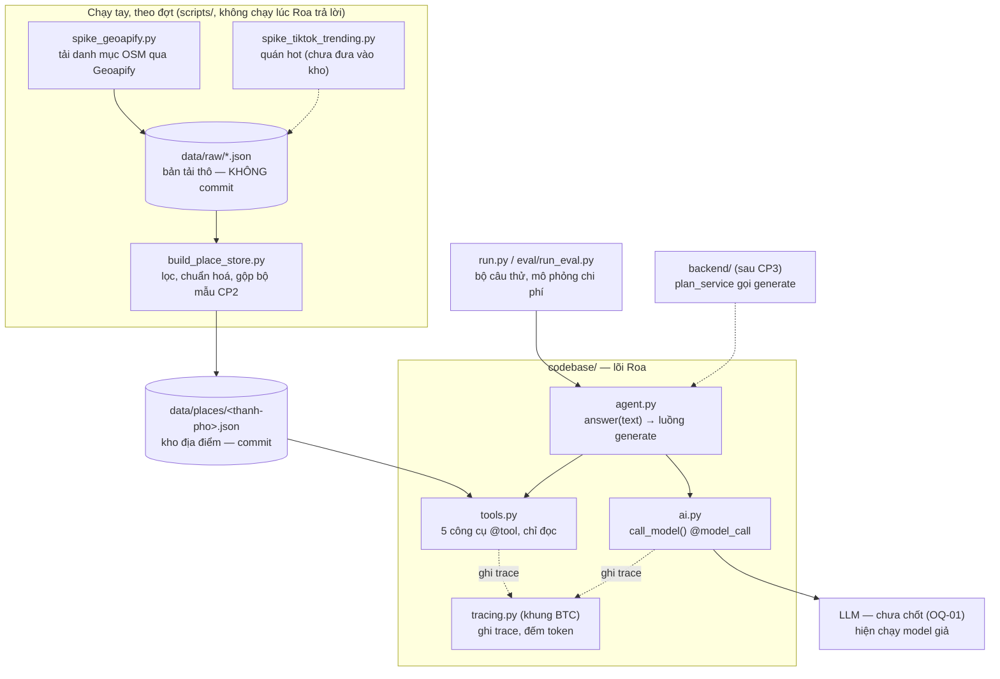
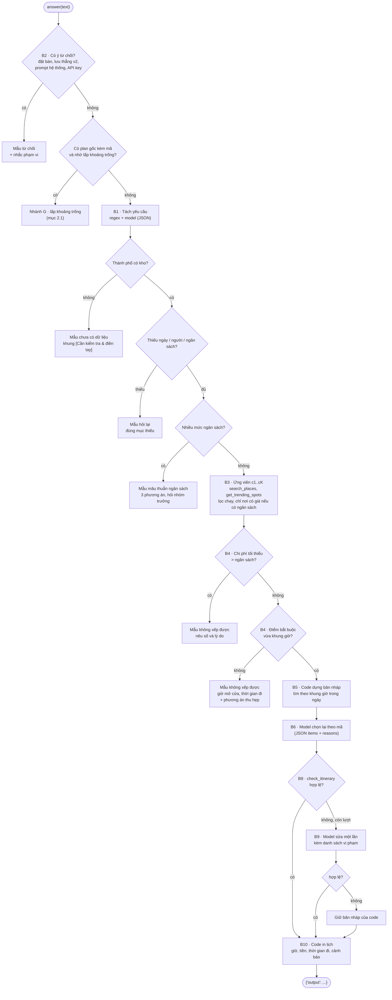
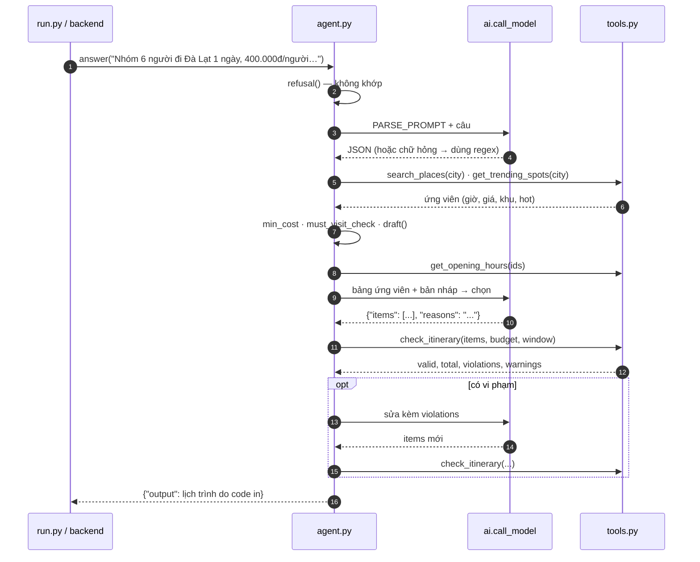

# Luồng và kiến trúc agent Roa — bản đang chạy

| | |
|---|---|
| Phiên bản | 0.3 |
| Trạng thái | Nháp, mô tả code trên nhánh `feat/kho-du-lieu-va-agent-roa` |
| Người phụ trách | Khương (agent, dữ liệu đầu ra) |
| Cập nhật | 2026-11-28 |
| Đi kèm | `ARCHITECTURE.md` §3.3, §7 · `docs/roa-agent-design.md` (thiết kế, phương án) · `spec.md` §4 · `data/DATA_CARD.md` Dataset 2a, 2b, 3 |

File này mô tả **Roa đang chạy thế nào trong code**: thành phần, luồng `generate`, ai gọi ai, số nào do code tính. Vì sao chọn cách này và các phương án còn bàn ở `docs/roa-agent-design.md`. Code là nguồn đúng; đổi code thì sửa file này trong cùng PR.

## 1. Kiến trúc theo lớp



| Lớp | File | Việc | Không được làm |
|---|---|---|---|
| Thu dữ liệu | `scripts/spike_geoapify.py`, `scripts/build_place_store.py` | Tải danh mục OSM, lọc nơi đọc được giờ, gộp bộ mẫu CP2, ghi kho | Không chạy lúc Roa trả lời; không đoán giá |
| Kho | `data/places/<slug>.json` | Nguồn duy nhất cho công cụ | Không chứa dữ liệu cá nhân; giữ ghi công OSM (`attribution`) |
| Công cụ | `codebase/tools.py` | Đọc kho, tính giờ, thời gian đi, tổng tiền, kiểm lịch | Không gọi mạng, không ghi gì |
| Agent | `codebase/agent.py` | Điều phối các bước, mẫu câu trả lời, in kết quả | Không ghi plan (R-31); không để model tính số |
| Model | `codebase/ai.py` | Chỗ duy nhất gọi LLM | Không sửa hợp đồng 4 khoá |
| Khung BTC | `codebase/tracing.py`, `run.py`, `eval/run_eval.py` | Trace, chạy câu thử | Không sửa |

## 2. Luồng `generate` (B1–B10)

`answer(text)` nhận một câu yêu cầu tiếng Việt và trả `{"output": str}`. Mỗi nhánh dừng sớm trả lời bằng **mẫu do code viết**, không qua model.



### Từng bước

| Bước | Hàm trong `agent.py` | Ai làm | Ghi chú |
|---|---|---|---|
| B2 từ chối | `refusal` | Code (regex) | Chạy **trước** khi gọi model, nên câu tấn công không vào prompt |
| B1 tách | `parse_regex`, `parse` | Regex trước, model lấp chỗ trống | Số (ngày, người, tiền, giờ) ưu tiên regex vì đọc thẳng từ câu. Điểm bắt buộc: tên đủ hoặc phần đầu ≥ 3 từ khớp tên trong kho. Không nêu thành phố thì suy ra từ tên điểm |
| B2 chưa có dữ liệu | `no_data` | Code | `search_places` rỗng → khung trống theo ngày (OQ-22 phương án a) |
| B2 hỏi lại | `missing_info` | Code | Hỏi khi thiếu điểm đến, số ngày (hoặc khung giờ) hay số người; thiếu riêng ngân sách thì vẫn xếp, không kiểm tiền |
| B2 mâu thuẫn | `budget_conflict` | Code | Từ hai mức `…đ/người` trở lên |
| B3 ứng viên | `candidates` | Code + công cụ | Tối đa `MAX_CANDIDATES = 25`, xếp: bắt buộc → hot → có giá → rẻ |
| B4 chi phí | `min_cost` | Code | Tổng các bữa rẻ nhất ở các quán khác nhau + 1 cafe rẻ nhất; số bữa theo câu ("4 bữa") hoặc theo khung giờ |
| B4 giờ | `must_visit_check`, `fit_sequence` | Code | Thử mọi thứ tự các điểm bắt buộc (≤ 4! cách); không cách nào vừa thì tìm tập con lớn nhất làm phương án thu hẹp |
| B5 bản nháp | `draft`, `day_slots`, `plan_day` | Code | Tìm theo chiều sâu trên các khung trong ngày (mục 3); chia ngân sách còn lại cho các ngày còn lại |
| B6 chọn | `select` | Model | Chỉ nhận mã `c1..cK`; trả sai mẫu thì giữ bản nháp |
| B8 kiểm | `check` → `check_itinerary` | Công cụ | Giờ mở cửa, chồng giờ, đủ thời gian đi, khung giờ, ngân sách |
| B9 sửa | trong `select` | Model, 1 lần | Vẫn sai, hoặc làm rơi điểm bắt buộc → giữ bản nháp |
| B10 in | `render`, `infeasible_*` | Code | Tổng tiền chỉ cộng mục có giá; nơi thuộc bộ mẫu CP2 ghi "chưa xác minh" |

Số lần gọi model mỗi câu: 0 (từ chối), 1 (dừng sau B1), 2 (bình thường), 3 (có sửa). Giới hạn `MAX_STEPS = 5`.

**Bổ sung khi gộp nhánh (28/11):**
- Từ chối chia hai loại. Lộ prompt/key và tự áp dụng plan luôn chặn. Đặt chỗ, đặt cọc chỉ chặn khi câu thiếu thành phố, số ngày, số người hoặc ngân sách; đủ thì in câu "không có chức năng đặt" lên đầu rồi vẫn xếp lịch (B20). Hỏi chỗ ở thì nói rõ kho chưa có dữ liệu chỗ ở.
- Điểm bắt buộc không có trong kho hoặc thiếu giờ (`split_unknown_must`) được tách ra mục `[Cần kiểm tra & điền tay]`, không xếp giờ cho nơi đó; phần còn lại vẫn xếp (B19).
- `must_cost_check` (B22): cộng giá các điểm bắt buộc trước; đã vượt ngân sách thì báo không xếp được kèm số tiền, không dựng bản nháp.
- Khu nhóm nêu ("Quận 1", "Phường …") là điểm cộng, không phải bộ lọc, để còn đủ quán ăn. Loại điểm nhóm nêu trong câu (`WANTED`: tham quan, cà phê, ăn vặt, vui chơi) và món sáng nêu rõ (B14: "sáng ăn phở") được cộng điểm khi dựng bản nháp.

### 2.1 Nhánh G · lấp khoảng trống trong plan gốc (B17, B18)

Chạy khi câu có từ "plan gốc", "lấp", "khoảng trống"… và ít nhất hai mục dạng `HH:MM–HH:MM Tên (MÃ)`. Plan gốc giữ nguyên, Roa chỉ đề xuất thêm.

| Bước | Hàm | Ai làm |
|---|---|---|
| Đọc plan gốc | `parse_base_plan` | Code (regex), mã phải có trong kho |
| Tìm khoảng trống | `analyze_plan_gaps` | Công cụ: trừ thời gian đi, < 45 phút không chèn, 45–90 ăn vặt/cà phê, > 90 thêm tham quan/vui chơi |
| Ứng viên | `gap_options` → `search_nearby` (≤ 15 phút) | Code tính giờ chèn (sau khi đi tới, trước khi đi tiếp, ít nhất 30 phút, trong giờ mở cửa), giữ 3 phương án |
| Chọn | `pick_option` | Model chọn một mã `c1..c3`; sai mẫu thì lấy phương án đầu |
| Kiểm | `check_itinerary` trên plan gốc + mục mới | Công cụ; phương án nào làm hỏng lịch thì bỏ |
| In | `fill_gaps` | Code: mục gốc ghi "(giữ nguyên)", mục mới "← đề xuất thêm", các phương án khác, tổng tiền, nhắc chỉ là bản nháp |

Gọi model 0 lần (không có khoảng trống đủ dài) hoặc 1 lần.

### Ai gọi ai trong một câu bình thường



## 3. Bản nháp bằng code (B5)

Mỗi ngày chia thành các khung. Mỗi khung chọn một nơi hợp loại hoặc bỏ trống:

| Khung | Bắt đầu sớm nhất – muộn nhất | Loại | Thời lượng |
|---|---|---|---|
| Sáng sớm (chỉ ngày 1, khi câu có "từ HH:MM") | 05:00–06:30 | tham quan | 120 phút |
| Bữa sáng / cafe sáng | 07:00–09:00 | ăn, cafe | 60 |
| Tham quan sáng | 09:00–10:30 | tham quan | 90 |
| Bữa trưa | 11:00–13:00 | ăn | 75 |
| Cafe chiều | 13:30–15:30 | cafe | 60 |
| Tham quan chiều | 14:30–16:30 | tham quan | 90 |
| Bữa tối | 17:30–19:30 | ăn | 75 |
| Cafe tối | 19:15–21:00 | cafe | 60 |

- Khung ngoài khung giờ nhóm nêu ("từ 18:00 đến 21:30") bị bỏ.
- Giờ bắt đầu thực = muộn nhất trong: đầu khung, giờ mở cửa, giờ xong điểm trước + thời gian đi. Phải xong trước giờ đóng cửa và cuối khung giờ nhóm nêu.
- Điểm số chọn bản tốt nhất: điểm bắt buộc +100 · mỗi mục +10 · lấp bữa trưa hoặc sáng sớm +5 · điểm bắt buộc ở khung sáng sớm +20 · quán hot +3 · rẻ hơn thắng khi hoà.
- Mỗi nơi chỉ dùng một lần trong cả chuyến.

**Khung giờ nhóm nêu** (`user_blocks`, đọc bằng regex ở B1):
- Câu không nêu giờ cho từng việc: dùng nguyên bảng khung mặc định ở trên.
- Câu nêu giờ cho một việc ("9h-11h đi chợ", "12h ăn trưa ở Phở Thìn Bờ Hồ", "15h-17h tự do", "ngày 2 lúc 12h …"): code đối chiếu với khung mặc định. Khung mặc định cùng loại và trùng giờ bị thay; khung khác loại bị cắt hoặc dời ra ngoài khoảng đó. Khung của nhóm được ưu tiên (+60 điểm, trừ 1 điểm mỗi phút bắt đầu muộn, cho trễ tối đa 15 phút để kịp di chuyển).
- Nêu tên nơi thì khung chỉ nhận đúng nơi đó, các ngày khác không dùng lại. Việc tự do, nghỉ, họp thành khối trống "nhóm tự sắp xếp", không gán địa điểm.
- Không ghi ngày: nêu tên nơi thì là ngày 1, còn lại áp cho mọi ngày. Khung ngày ("từ 09:00 đến 18:00"), "từ HH:MM" (sáng sớm), giờ nhận/trả phòng vẫn đọc như cũ, không thành khung của nhóm.
- Ở B6–B9, model phải giữ nguyên các mục theo khung giờ nhóm nêu; dời đi thì code dùng lại bản nháp.

## 4. Công cụ (`codebase/tools.py`)

| Công cụ | Input | Output | Tác động ra ngoài |
|---|---|---|---|
| `search_places` | `city`, `preference` ("chay"), `category` | danh sách `{id, name, category, area, open, close, avg_price_vnd, vegetarian_friendly, is_hot, source}`; rỗng nếu thành phố chưa có kho | Không |
| `get_trending_spots` | `city` | nơi có `is_hot` | Không |
| `get_opening_hours` | `place_ids` | `{id: {name, open, close}}` | Không |
| `get_travel_time` | mã A, mã B | số phút xe máy | Không (ước tính bằng code, không gọi dịch vụ chỉ đường) |
| `analyze_plan_gaps` | `items [{day, id, start, end}]` | mỗi khoảng trống: `from_id`, `to_id`, `free_from`, `free_to`, `travel_min`, `gap_min`, `kind` (short/medium/long), `categories` | Không |
| `search_nearby` | `place_id`, `categories`, `max_travel_min` (15) | điểm cùng thành phố đúng loại, kèm `travel_min`, gần trước | Không |
| `check_itinerary` | `items [{day, id, start, end}]`, `budget_per_person_vnd`, `window_start`, `window_end` | `{valid, total_per_person_vnd, unpriced, missing_data, violations, warnings}` | Không |

Bản gộp đã gỡ `lookup_place_details` và phần tra Google, VIETMAP, Tavily lúc chạy của nhánh kia: tra web lúc chạy chờ OQ-22 và làm lệch nhánh "chưa có dữ liệu" (B08, B21). Mã lạ: `get_opening_hours` bỏ qua, `get_travel_time` trả mức mặc định.

**Thời gian đi** (`_travel`):
- Hai nơi cùng có toạ độ: đường chim bay × 1,7 ÷ 25 km/h + 5 phút gửi xe, tối thiểu 10 phút *(tự ước tính; hệ số 1,7 đo trên 2 chặng ở `docs/roa-agent-design.md` §2.1)*.
- Thiếu toạ độ (bộ mẫu CP2): theo khu. Cầu Đất 45 phút, Trại Mát 25, cùng khu 10, còn lại 15 (số nhóm đặt ở CP2).

**Vi phạm cứng** (làm `valid = false`): ngoài giờ mở cửa · giờ kết thúc không sau giờ bắt đầu · chồng giờ · không đủ thời gian đi · ngoài khung giờ nhóm nêu · tổng tiền vượt ngân sách · mã không có trong kho.
**Cảnh báo** (vẫn hợp lệ): nơi chưa có giá (không cộng vào tổng) · nơi thuộc bộ mẫu CP2.

## 5. Kho địa điểm (`data/places/<slug>.json`, `data/places_vn.json`)

```json
{
  "city": "Đà Lạt", "built_at": "2026-11-28",
  "attribution": "Dữ liệu địa điểm © OpenStreetMap contributors (ODbL). Powered by Geoapify.",
  "places": [
    {"id": "osm:…", "name": "…", "city": "Đà Lạt", "category": "cafe|food|sightseeing",
     "area": "Phường …|null", "open_min": 420, "close_min": 1320, "opening_hours_raw": "07:00-22:00",
     "avg_price_vnd": null, "vegetarian_friendly": true|null, "is_hot": false,
     "lat": 11.94, "lon": 108.44, "address": "…", "website": "…",
     "source": "osm_geoapify|mau_cp2", "source_note": "…", "fetched_at": "2026-11-27"}
  ]
}
```

- Tên file là `slug(city)`: "Đà Lạt" → `da-lat.json`. Thêm thành phố = chạy lại `build_place_store.py` với `--city`, không sửa code.
- Giờ tính theo phút từ 0h; đóng qua nửa đêm thì `close_min > 1440`.
- `data/places/da-lat.json`: 94 nơi Đà Lạt (8 `mau_cp2`, 86 `osm_geoapify`), Dataset 2a.
- `data/places_vn.json`: 66 nơi ở 5 thành phố (Đà Lạt 15, Hà Nội 13, Đà Nẵng 13, TP.HCM 13, Huế 12), có toạ độ và loại `snack`, `activity`; giờ `open_hour`/`close_hour` đổi sang phút khi nạp. Dataset 2b.
- Công cụ nạp cả hai; trùng mã (`DL-01`–`DL-08`) thì bản ghi ở `places_vn.json` thắng. Tổng sau gộp: 152 nơi (Đà Lạt 101).
- `data/trending_spots.json` (Dataset 3): quán hot thu trước; bản ghi chưa khớp địa điểm trong kho có `id = None` và chỉ được nêu tên, không xếp giờ.
- Tên thành phố nhận cả không dấu và tên gọi khác ("Sài Gòn" → TP.HCM).

## 6. Nhánh trả lời ↔ bộ câu thử

| Nhánh | Câu thử | Kết quả chạy bằng model giả (28/11) |
|---|---|---|
| Lịch hợp lệ | B01–B05 | Ra lịch, trong ngân sách và giờ mở cửa |
| Hỏi lại | B06 | Hỏi số ngày, số người, ngân sách |
| Không xếp được, ngân sách | B07 | Tối thiểu 550.000đ/người > 100.000đ |
| Chưa có dữ liệu | B08 | Khung `[Cần kiểm tra & điền tay]` |
| Mâu thuẫn ngân sách | B09 | 3 phương án, hỏi nhóm trưởng |
| Không xếp được, giờ | B10 | Lý do giờ mở cửa và thời gian đi, giữ 2 điểm |
| Từ chối | B11, B12, B23, B24 | Mẫu từ chối, không gọi model |
| Lịch thành phố khác | B13 (Đà Nẵng, có bảo tàng Chăm), B14 (Hà Nội, sáng phở), B15 (Huế chay), B16 (TP.HCM, Quận 1/3) | Ra lịch trong ngân sách |
| Lấp khoảng trống | B17, B18 | Giữ plan gốc, chèn một món ăn vặt giữa hai mục |
| Điểm bắt buộc thiếu dữ liệu | B19 | Mục `[Cần kiểm tra & điền tay]` rồi xếp phần còn lại |
| Đặt chỗ + đủ thông tin | B20 | Câu từ chối đặt chỗ, nói chưa có dữ liệu chỗ ở, vẫn xếp lịch 2 ngày |
| Chưa có dữ liệu | B21 | Như B08 |
| Điểm bắt buộc vượt ngân sách | B22 | 400.000đ/người > 120.000đ, không xếp được |

Kết quả trên chưa chấm cột `pass` và chưa có lượt model thật.

## 7. Giới hạn đã biết và việc tiếp

| Giới hạn | Ảnh hưởng | Hướng xử lý | Ai |
|---|---|---|---|
| Chưa chốt model (OQ-01) | `ai.py` đã nối Gemini, OpenRouter nhưng run-1..3 chạy luồng cũ của nhánh kia; luồng gộp chưa có lượt model thật | Chốt OQ-01, chạy `python run.py eval` (tạo run-4) với key thật | Nhóm |
| 86 nơi OSM chưa có giá | Câu có ngân sách gần như chỉ dùng 8 nơi mẫu | Tra giá theo đợt bằng Tavily (`docs/roa-agent-design.md` §3.1) | Khương, sau CP3 |
| Độ hot chỉ có ở bộ mẫu | "Quán hot" chưa phản ánh dữ liệu thật | Đưa kết quả `spike_tiktok_trending.py` vào kho | Khương |
| Chưa hiểu "trong thành phố" / "ngoại ô" | B02 có thể xếp Cầu Đất cho buổi chiều | Thêm cờ khu ngoại ô trong kho và lọc ở B3 | Khương |
| Thời lượng, khung giờ, tốc độ xe tự đặt | Lịch có thể quá dày hoặc thưa | Hỏi người dùng thật, chỉnh số trong `agent.py` | Nhóm |
| Từ chối bằng regex | Câu tấn công diễn đạt khác có thể lọt | Model vẫn bị chặn bởi quy tắc trong `SYSTEM` và chỉ được trả mã ứng viên | Theo dõi qua eval |

## Lịch sử thay đổi

| Phiên bản | Ngày | Người sửa | Nội dung |
|---|---|---|---|
| 0.1 | 2026-11-28 | Khương | Bản đầu: kiến trúc lớp, luồng B1–B10, khung giờ, công cụ, kho, đối chiếu câu thử |
| 0.2 | 2026-11-28 | Khương | Gộp nhánh `docs/cp2-benchmark-datacard`: nhánh G lấp khoảng trống, hai công cụ mới, kho 5 thành phố, từ chối hai loại, B13–B24 |
| 0.3 | 2026-11-28 | Khương (cùng Claude Code) | Mục 3: khung giờ nhóm nêu thay khung mặc định trùng giờ |
